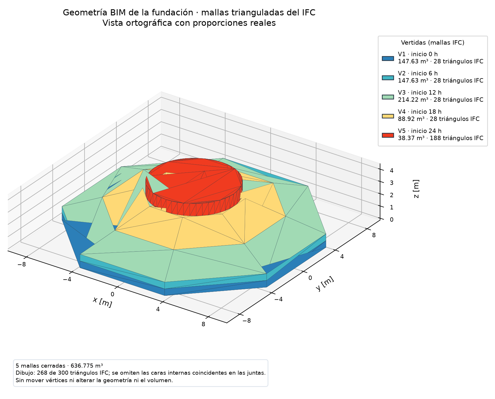

# Dossier térmico y BIM · E13

**Repositorio:** [vaurmeneta-22/P2-Grupo-3](https://github.com/vaurmeneta-22/P2-Grupo-3)  
**Commit base (HEAD):** `d9600b45cbc7444e653d579cfe00c9caf14e2ee7`. **SHA evaluado:** pendiente de crear después de guardar estos cambios; el manifiesto deja `commit: null` porque Git no pudo consultar el estado del árbol.  
**Configuración:** inicio jueves 19-11-2026 a las 10:00 local (`2026-11-19T13:00:00Z`), horizonte de 14 días, Δx = 0,25 m, Δt máximo = 600 s.

## Entradas

Se usa el IFC versionado `models/ifc/Fundacion_1_con_propiedades.ifc`. Su volumen geométrico es 636,775 m³ y la altura total 4,30 m. Dimensiones por vertida: V1 18 × 18 × 0,55 m (147,626 m³); V2 18 × 18 × 0,55 m (147,626 m³); V3 18 × 18 × 1,10 m (214,224 m³); V4 12,5 × 12,5 × 1,10 m (88,925 m³); V5 7 × 7 × 1,00 m (38,375 m³). A Δx = 0,25 m, la voxelización estima 633,375 m³, error relativo 0,534 %.

La obra se evalúa con tres trayectorias GEFS completas de 337 registros horarios, seleccionadas como escenarios frío, central y cálido y ponderadas por sus grupos representados: 11/31, 10/31 y 10/31. El pronóstico fue consultado el 16-11-2026; es GEFS de unos 50 km y resolución nativa de 3 h, interpolado a horas por Open-Meteo. La ventana simulada va del 19-11 10:00 al 03-12 10:00 local. No es una observación ni garantiza el clima real de obra.


El IFC identifica hormigón M1. **M1_SS es la fuente nominal** y **M1_22A se corre por separado como sensibilidad**, sin mezclar ambas en la probabilidad nominal. Las ocho curvas originales del profesor se grafican en `results/dossier_final/curvas_hidratacion_8_series.png`; `Q̇` se aplica directamente en W/m³, y se asume cola cero después de la última muestra.


## Verificación automática

La suite terminó con **200 passed, 1 skipped**. La matriz térmica nominal considera cuatro planes × tres climas; la sensibilidad M1_22A tiene su propia matriz y carpeta.

| Test | Qué verifica | Error/métrica | Resultado |
|---|---|---:|---|
| Solución analítica 1D | FTCS frente a solución exacta | Suite automatizada | Pasó |
| Soluciones 2D/3D | Decaimiento sinusoidal | Suite automatizada | Pasó |
| Energía adiabática | Conservación sin flujo ni fuente | Residuo máximo de convergencia: 6,1×10⁻⁵ J | Pasó |
| Fuente uniforme | Aumento de T y energía inyectada | Suite automatizada; balance de energía cerrado | Pasó |
| Condición Robin | Equilibrio, enfriamiento y flujo convectivo | Suite automatizada | Pasó |
| Convergencia espacial | Δx 0,50 → 0,25 m, Δt fino | ΔM_T = 0,322 °C; ΔM_Δ = 0,682 °C | Clasificación no cambia |
| Convergencia temporal | Δt máx. 600 → 300 s, Δx = 0,25 m | ΔM_T = 0,003 °C; ΔM_Δ = 0,003 °C | Clasificación no cambia |

La tabla completa de convergencia está en `results/dossier_final/convergencia_numerica.csv`. El test del balance energético de la simulación completa también deja un residuo pequeño frente a las energías acumuladas.

## Resultado de planes y criterios

Se evalúan `propuesto_6h`, `continuo_36m3_h`, `rapido_4_5h` y `lento_8h`. Se define `M_T` como máxima temperatura de todo el hormigón activo y `M_Δ = max_t(Tmax − Tmin(S25))`, donde S25 se estima a 25 mm desde las seis caras exteriores actuales. Los límites son 70 °C, 20 °C y `P_f ≤ 0,05`; el fallo es la unión de los dos primeros eventos.

Con M1_SS, `P_T = 0` y `P_Δ = P_f ≈ 1` para cada plan: M_T alcanza aproximadamente 57,6–57,7 °C, mientras M_Δ alcanza 37,2–38,6 °C. Ningún plan evaluado cumple. La sensibilidad M1_22A también da `P_T = 0` y `P_f ≈ 1`; M_T ronda 46,5 °C y M_Δ 26,3–28,3 °C. El límite que gobierna es el gradiente interior-superficie, no la temperatura absoluta. No se declara un plan factible ni se afirma que la lista de alternativas sea una optimización global.

El diagnóstico de horizonte compara 312 h con 336 h para cada vertida del plan propuesto: Tmax disminuye entre 0,66 y 1,05 °C durante las últimas 24 h. El archivo `diagnostico_horizonte_y_una_vertida.csv` incluye también un caso idealizado con todas las partes del IFC activadas en `t=0`: M_T ≈ 57,70 °C y M_Δ ≈ 39,72 °C. Es una comparación geométrica/térmica, no una programación ejecutable.

## BIM y simplificaciones



Simplificaciones declaradas: voxelización cartesiana tipo staircase; propiedades térmicas homogéneas del material M1; hidratación depende de edad y usa Q̇ tabulado, no una cinética calibrada dependiente de T; cola cero de fuente tras el registro; activación térmica instantánea por vertida en la matriz de planes; suelo como resistencia efectiva sin almacenamiento; moldaje/aislación con propiedades asumidas; S25 reconstruida por interpolación; clima GEFS de resolución espacial limitada. El piloto de colocación progresiva está en `results/dossier_final/comparacion_activacion_vertidas.csv` y no reemplaza la matriz.

## Reproducción

Desde la raíz del repositorio, en PowerShell:

```powershell
$env:PYTHONPATH = "src"
python scripts/evaluar_dossier_final.py
python scripts/evaluar_dossier_final.py --sensibilidad
python scripts/verificar_convergencia_final.py
python scripts/diagnostico_horizonte_final.py
python scripts/graficar_curvas_hidratacion.py
python scripts/graficar_climas_gefs_tres_trayectorias.py
python -m pytest -q -p no:cacheprovider
```

El snapshot GEFS y el archivo original del ensamble están versionados bajo `data/weather/2026-11-16T213220Z_GEFS_*`; las configuraciones reproducibles están en `configs/evaluacion_final.jsonc` y `configs/climas/gefs_20261116/`.
