# Difusión de calor: desde 1D hasta 3D con diferencias finitas

> **Material de apoyo — Design by Simulation in Civil Engineering**  
> Aplicación principal: modelación térmica de hormigón masivo.

---

## 0. Objetivos

Al terminar esta guía deberías ser capaz de:

1. explicar de dónde viene la ecuación de difusión de calor;
2. interpretar físicamente conductividad, capacidad térmica y difusividad;
3. discretizar la ecuación en 1D, 2D y 3D;
4. implementar un esquema explícito de diferencias finitas;
5. reconocer y programar condiciones de borde de Dirichlet, Neumann y Robin;
6. incorporar una fuente volumétrica de calor;
7. verificar el código con soluciones conocidas;
8. identificar inestabilidad y falta de convergencia;
9. conectar esta teoría con el problema de hormigón masivo.

> Esta guía usa la sintaxis de Obsidian: `$...$` para matemática inline y `$$...$$` para matemática en bloque.

---

# 1. El problema físico

Si dos regiones de un material tienen temperaturas distintas, aparece transferencia de calor desde la región de mayor temperatura hacia la de menor temperatura.

La descripción macroscópica básica es la **ley de Fourier**:

$$
\mathbf{q}=-k\nabla T
$$

donde:

| Símbolo | Significado | Unidad SI |
|---|---|---|
| $T$ | temperatura | K o °C |
| $\mathbf{q}$ | flujo de calor por unidad de área | W/m² |
| $k$ | conductividad térmica | W/(m·K) |
| $\nabla T$ | gradiente de temperatura | K/m |

El signo negativo significa que **el calor fluye cuesta abajo en temperatura**.

En una dimensión:

$$
q_x=-k\frac{\partial T}{\partial x}
$$

---

# 2. Conservación de energía

Para un volumen pequeño:

$$
\text{acumulación}
=
\text{entrada}
-
\text{salida}
+
\text{generación}
$$

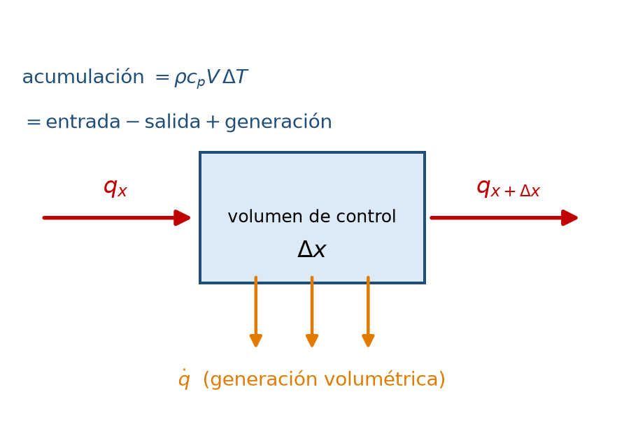

La energía térmica almacenada depende de:

$$
\rho c_p VT
$$

donde $\rho$ es la densidad, $c_p$ el calor específico y $V$ el volumen.

Combinando conservación de energía con la ley de Fourier:

$$
\rho c_p\frac{\partial T}{\partial t}
=
\nabla\cdot(k\nabla T)
+
\dot q
$$

Si $k$ es constante:

$$
\rho c_p\frac{\partial T}{\partial t}
=
k\nabla^2T+\dot q
$$

o:

$$
\frac{\partial T}{\partial t}
=
\alpha\nabla^2T
+
\frac{\dot q}{\rho c_p}
$$

con:

$$
\boxed{\alpha=\frac{k}{\rho c_p}}
$$

La cantidad $\alpha$ es la **difusividad térmica**.

---

# 3. ¿Qué significa la difusividad?

- $k$ alto: el calor se transmite fácilmente.
- $\rho c_p$ alto: cuesta más cambiar la temperatura del material.
- $\alpha$ alto: las perturbaciones térmicas se redistribuyen rápidamente.

Una escala de tiempo útil es:

$$
t_d\sim\frac{L^2}{\alpha}
$$

Por eso el tamaño importa tanto en hormigón masivo.

Si:

$$
L\rightarrow2L
$$

entonces:

$$
t_d\rightarrow4t_d
$$

Un elemento dos veces más grueso tarda aproximadamente cuatro veces más en difundir térmicamente una perturbación.

---

# 4. Número de Fourier

El número de Fourier es:

$$
Fo=\frac{\alpha t}{L^2}
$$

Interpretación:

- $Fo\ll1$: la difusión apenas ha avanzado respecto de $L$;
- $Fo\sim1$: la perturbación térmica ya recorrió una distancia del orden de $L$;
- $Fo\gg1$: ha habido mucho tiempo para redistribución térmica.

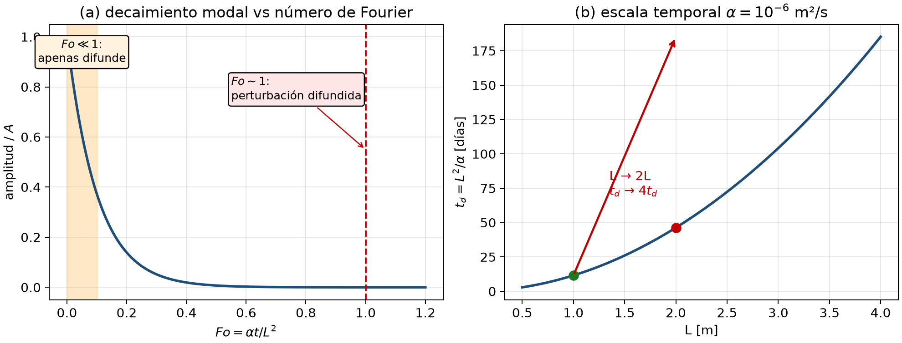

Este mismo cociente aparece en la estabilidad del esquema explícito.

---

# 5. Problema 1D

En una barra o muro donde la temperatura sólo cambia con $x$:

$$
\frac{\partial T}{\partial t}
=
\alpha\frac{\partial^2T}{\partial x^2}
+
\frac{\dot q}{\rho c_p}
$$

Primero tomemos $\dot q=0$.

Definimos:

$$
x_i=i\Delta x
$$

y:

$$
t^n=n\Delta t
$$

Aproximamos:

$$
\frac{\partial T}{\partial t}
\approx
\frac{T_i^{n+1}-T_i^n}{\Delta t}
$$

y:

$$
\frac{\partial^2T}{\partial x^2}
\approx
\frac{T_{i+1}^n-2T_i^n+T_{i-1}^n}{\Delta x^2}
$$

Sustituyendo:

$$
T_i^{n+1}
=
T_i^n
+
r
\left(
T_{i+1}^n-2T_i^n+T_{i-1}^n
\right)
$$

con:

$$
r=\frac{\alpha\Delta t}{\Delta x^2}
$$

Este esquema se conoce como **FTCS: Forward-Time Centered-Space**.

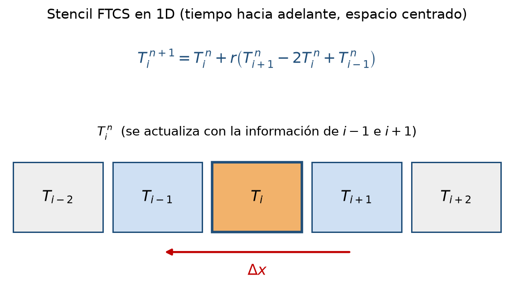

---

# 6. Estabilidad explícita en 1D

La condición clásica es:

$$
\boxed{r\le\frac12}
$$

o:

$$
\boxed{
\Delta t
\le
\frac{\Delta x^2}{2\alpha}
}
$$

Consecuencia práctica:

> Si dividimos $\Delta x$ por 2, el paso de tiempo estable disminuye aproximadamente por un factor 4.

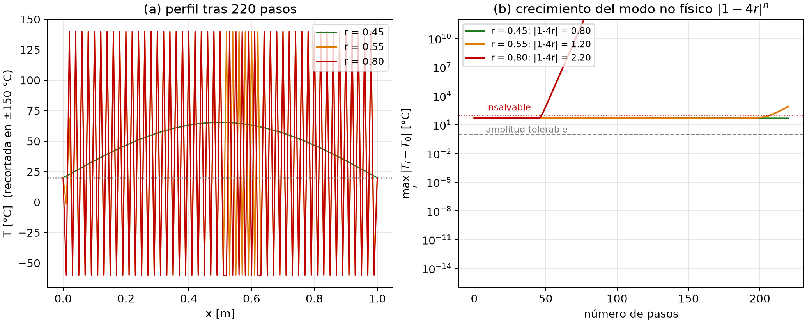

En la figura, los tres casos usan el mismo número de pasos: sólo cambia $r$. El panel (a) muestra los perfiles finales; el panel (b) cuantifica cómo crece la amplitud del modo no físico: con $r=0.45$ decae suavemente, mientras que con $r>1/2$ aparece una oscilación en dientes de sierra (modo tablero de ajedrez) que crece como $|1-4r|^n$ hasta hacerse insalvable.

---

# 7. Verificación 1D con solución exacta

Usaremos:

$$
T(x,0)
=
T_0+A\sin\left(\frac{\pi x}{L}\right)
$$

con:

$$
T(0,t)=T(L,t)=T_0
$$

La solución exacta es:

$$
T(x,t)
=
T_0
+
A\sin\left(\frac{\pi x}{L}\right)
\exp\left[
-\alpha\left(\frac{\pi}{L}\right)^2t
\right]
$$

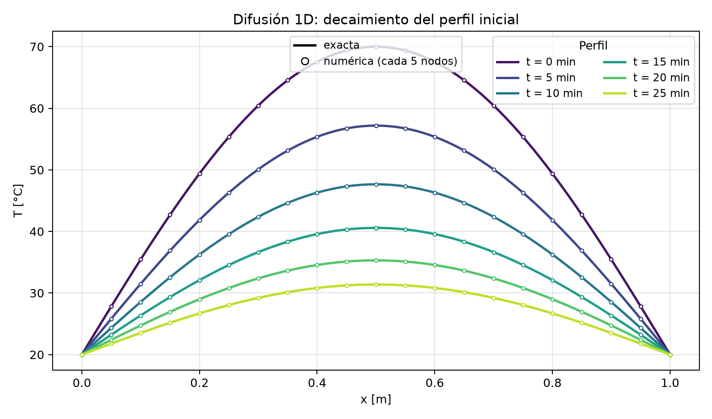

La figura muestra seis perfiles temporales: línea continua para la solución exacta y marcadores para la solución numérica. Así se aprecia directamente el decaimiento de la perturbación térmica.

## Código ejecutable

```python
import numpy as np
import matplotlib.pyplot as plt
from matplotlib.lines import Line2D
from pathlib import Path

ROOT = Path(__file__).resolve().parents[1]
FIG = ROOT / "images"   # figuras que se insertan en esta guía
OUT = ROOT / "output"   # campos y datos guardados
FIG.mkdir(exist_ok=True)
OUT.mkdir(exist_ok=True)

L = 1.0                 # m
alpha = 1.0e-4          # m^2/s
T0 = 20.0               # °C
A = 50.0                # °C

nx = 101
x = np.linspace(0.0, L, nx)
dx = x[1] - x[0]

# FTCS explícito. En 1D: r <= 1/2
r_target = 0.45
dt = r_target * dx**2 / alpha
t_end = 1500.0
nsteps = int(np.ceil(t_end / dt))
dt = t_end / nsteps
r = alpha * dt / dx**2

T = T0 + A * np.sin(np.pi * x / L)
T[0] = T0
T[-1] = T0

# Seis perfiles equiespaciados en el tiempo para mostrar la difusión.
snapshot_steps = np.rint(np.linspace(0, nsteps, 6)).astype(int)
snapshots = {0: T.copy()}

for n in range(1, nsteps + 1):
    Told = T.copy()
    T[1:-1] = Told[1:-1] + r * (
        Told[2:] - 2.0*Told[1:-1] + Told[:-2]
    )
    T[0] = T0
    T[-1] = T0

    if n in snapshot_steps:
        snapshots[n] = T.copy()

Texact = T0 + A*np.sin(np.pi*x/L) * np.exp(
    -alpha*(np.pi/L)**2*t_end
)

err_inf = np.max(np.abs(T - Texact))
print(f"dx = {dx:.5e} m")
print(f"dt = {dt:.5e} s")
print(f"r  = {r:.5f}")
print(f"Error L_inf = {err_inf:.6e} °C")

fig, ax = plt.subplots(figsize=(8.5, 5.0))
colors = plt.cm.viridis(np.linspace(0.05, 0.90, len(snapshot_steps)))

for step, color in zip(snapshot_steps, colors):
    t = step * dt
    exact = T0 + A*np.sin(np.pi*x/L) * np.exp(
        -alpha*(np.pi/L)**2*t
    )
    ax.plot(x, exact, color=color, lw=2.0,
            label=f"t = {t/60:.0f} min")
    ax.plot(x, snapshots[step], "o", color=color, ms=3.0,
            mfc="white", mew=0.9, markevery=5, label="_nolegend_")

time_legend = ax.legend(title="Perfil", loc="upper right", ncol=2,
                        fontsize=9, title_fontsize=10)
ax.add_artist(time_legend)
ax.legend(handles=[
    Line2D([0], [0], color="black", lw=2, label="exacta"),
    Line2D([0], [0], marker="o", color="black", lw=0, mfc="white",
           label="numérica (cada 5 nodos)"),
], loc="upper center", fontsize=9)

plt.xlabel("x [m]")
plt.ylabel("T [°C]")
plt.title("Difusión 1D: decaimiento del perfil inicial")
plt.grid(True, alpha=0.35)
plt.tight_layout()
plt.savefig(FIG / "01_1d_dirichlet.png", dpi=180)
plt.close(fig)
```

## Qué mirar

1. La forma sinusoidal se conserva en todos los instantes.
2. La amplitud decae exponencialmente: los perfiles se acercan a $T_0$.
3. Los marcadores numéricos deben superponerse a las líneas exactas.
4. Los bordes se mantienen exactamente en $T_0$.
5. El error debe disminuir al refinar la grilla.

---

# 8. Convergencia espacial

Una verificación no debería quedarse en “las curvas se parecen”.

Definimos, por ejemplo:

$$
e_\infty
=
\max_i
\left|
T_i^{num}-T_i^{exacta}
\right|
$$

y repetimos con varias resoluciones.

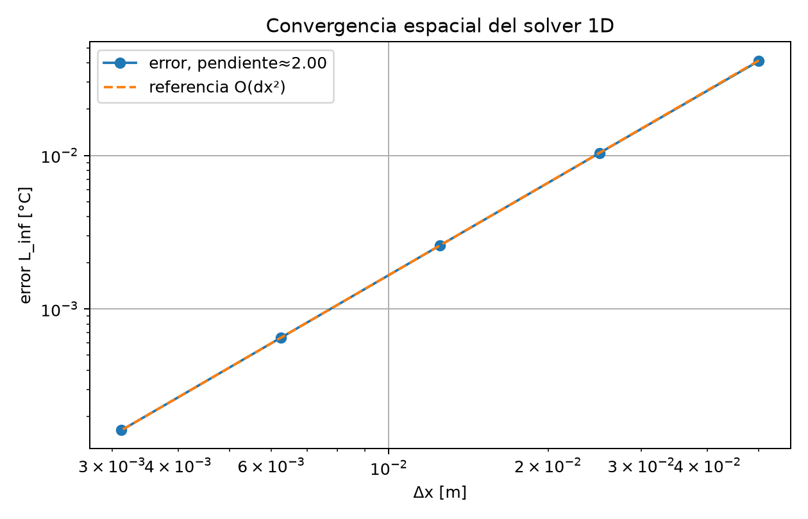

## Código

```python
import numpy as np
import matplotlib.pyplot as plt
from pathlib import Path

ROOT = Path(__file__).resolve().parents[1]
FIG = ROOT / "images"   # figuras que se insertan en esta guía
OUT = ROOT / "output"   # campos y datos guardados
FIG.mkdir(exist_ok=True)
OUT.mkdir(exist_ok=True)

L = 1.0
alpha = 1.0e-4
T0 = 20.0
A = 50.0
t_end = 1000.0

nxs = np.array([21, 41, 81, 161, 321])
errors = []
dxs = []

for nx in nxs:
    x = np.linspace(0,L,nx)
    dx = x[1]-x[0]
    dt = 0.35*dx**2/alpha
    nsteps = int(np.ceil(t_end/dt))
    dt = t_end/nsteps
    r = alpha*dt/dx**2

    T = T0 + A*np.sin(np.pi*x/L)
    T[0]=T0
    T[-1]=T0

    for _ in range(nsteps):
        Told=T.copy()
        T[1:-1]=Told[1:-1]+r*(Told[2:]-2*Told[1:-1]+Told[:-2])
        T[0]=T0
        T[-1]=T0

    exact = T0 + A*np.sin(np.pi*x/L)*np.exp(-alpha*(np.pi/L)**2*t_end)
    errors.append(np.max(np.abs(T-exact)))
    dxs.append(dx)

dxs=np.array(dxs)
errors=np.array(errors)

p = np.polyfit(np.log(dxs), np.log(errors), 1)[0]
print(f"Pendiente aproximada log(error)-log(dx): {p:.3f}")

plt.figure(figsize=(7,4.5))
plt.loglog(dxs, errors, "o-", label=f"error, pendiente≈{p:.2f}")
plt.loglog(dxs, errors[-1]*(dxs/dxs[-1])**2, "--", label="referencia O(dx²)")
plt.xlabel("Δx [m]")
plt.ylabel("error L_inf [°C]")
plt.title("Convergencia espacial del solver 1D")
plt.legend()
plt.grid(True)
plt.tight_layout()
plt.savefig(FIG/"04_1d_convergence.png", dpi=180)
plt.close()
```

Para el stencil centrado en espacio esperamos aproximadamente convergencia de segundo orden respecto de $\Delta x$ si el error temporal se mantiene suficientemente controlado.

---

# 9. Condiciones de borde

Resolver la PDE dentro del dominio no basta. Debemos indicar qué ocurre en la frontera.

Las tres condiciones fundamentales son:

1. Dirichlet;
2. Neumann;
3. Robin.

---

## 9.1 Dirichlet: temperatura impuesta

$$
T=T_b
$$

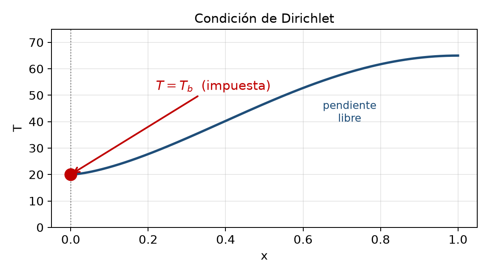

Ejemplos:

- superficie mantenida a temperatura conocida;
- baño térmico ideal;
- benchmark matemático.

Implementación:

```python
T[0] = Tb
```

**Advertencia:** que sea fácil de programar no significa que represente bien una superficie real.

---

## 9.2 Neumann: flujo impuesto

$$
-k\nabla T\cdot\mathbf n=q_n''
$$

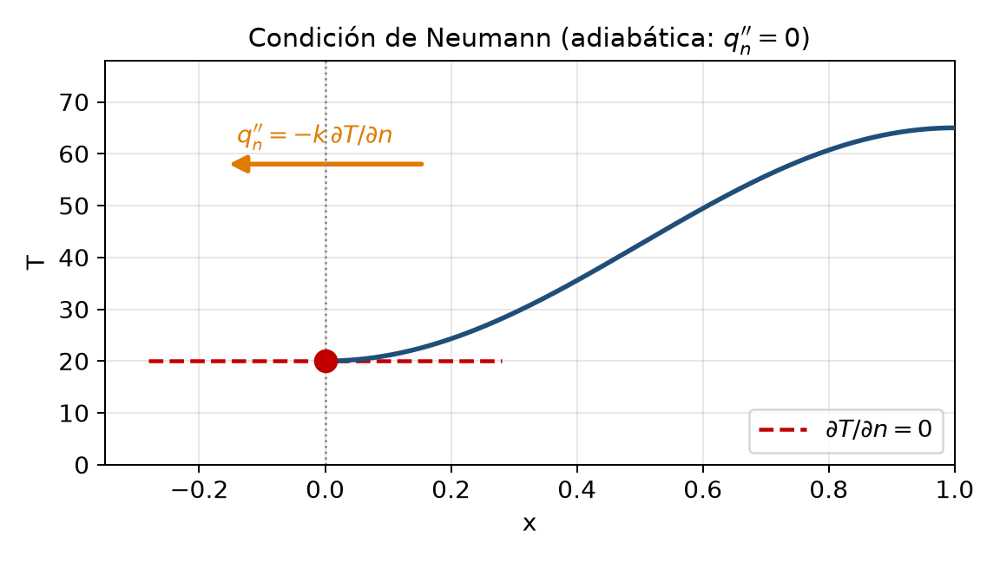

El caso más importante es una superficie adiabática:

$$
q_n''=0
$$

entonces:

$$
\frac{\partial T}{\partial n}=0
$$

También aparece naturalmente en un plano de simetría térmica.

---

# 10. Ejemplo 1D con Neumann adiabático

Condiciones:

- extremo izquierdo: $T=60^\circ$C;
- extremo derecho: adiabático;
- barra inicialmente a $20^\circ$C.

El extremo derecho no pierde calor. A largo plazo toda la barra tiende a $60^\circ$C.

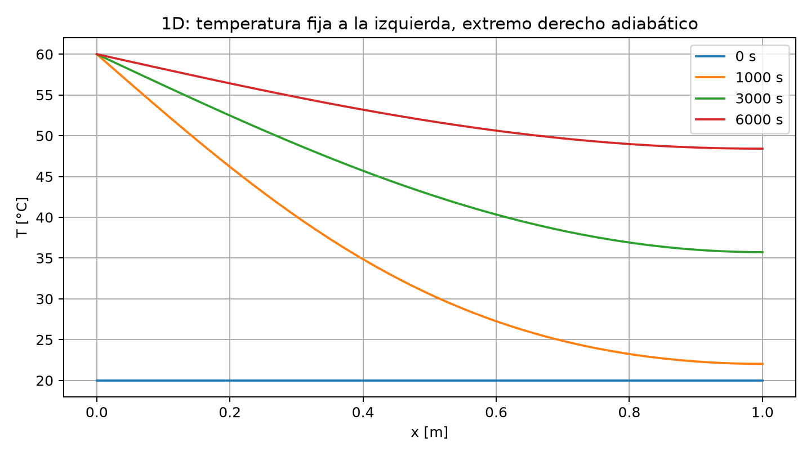

## Código

```python
import numpy as np
import matplotlib.pyplot as plt
from pathlib import Path

ROOT = Path(__file__).resolve().parents[1]
FIG = ROOT / "images"   # figuras que se insertan en esta guía
OUT = ROOT / "output"   # campos y datos guardados
FIG.mkdir(exist_ok=True)
OUT.mkdir(exist_ok=True)

L = 1.0
alpha = 1.0e-4

nx = 101
x = np.linspace(0.0, L, nx)
dx = x[1] - x[0]

r_target = 0.45
dt = r_target*dx**2/alpha
t_end = 6000.0
nsteps = int(np.ceil(t_end/dt))
dt = t_end/nsteps
r = alpha*dt/dx**2

T = np.full(nx, 20.0)

# x=0: Dirichlet T=60 °C
# x=L: Neumann adiabático dT/dx=0
snap_times = [0.0, 1000.0, 3000.0, 6000.0]
snapshots = {0.0: T.copy()}
next_snap = 1

for n in range(1, nsteps+1):
    Told = T.copy()

    T[1:-1] = Told[1:-1] + r*(
        Told[2:] - 2*Told[1:-1] + Told[:-2]
    )

    T[0] = 60.0

    # Ghost node:
    # dT/dx = 0 => T_ghost = T[-2]
    # Laplaciano en el borde => 2(T[-2]-T[-1])/dx^2
    T[-1] = Told[-1] + 2*r*(Told[-2] - Told[-1])

    t = n*dt
    if next_snap < len(snap_times) and t >= snap_times[next_snap]:
        snapshots[snap_times[next_snap]] = T.copy()
        next_snap += 1

plt.figure(figsize=(8,4.5))
for ts in snap_times:
    plt.plot(x, snapshots[ts], label=f"{ts:.0f} s")
plt.xlabel("x [m]")
plt.ylabel("T [°C]")
plt.title("1D: temperatura fija a la izquierda, extremo derecho adiabático")
plt.legend()
plt.grid(True)
plt.tight_layout()
plt.savefig(FIG/"02_1d_neumann.png", dpi=180)
plt.close()

print(f"T en extremo adiabático al final: {T[-1]:.3f} °C")
print("El estado estacionario esperado es T=60 °C en toda la barra.")
```

## Test físico

El estado estacionario esperado es:

$$
T(x)\rightarrow60^\circ\mathrm{C}
$$

en todo el dominio.

Si tu código no tiende a eso, algo está mal aunque “la figura se vea suave”.

---

# 11. Robin: convección

Una superficie real expuesta al aire se modela frecuentemente mediante:

$$
-k\nabla T\cdot\mathbf n
=
h(T_s-T_\infty)
$$

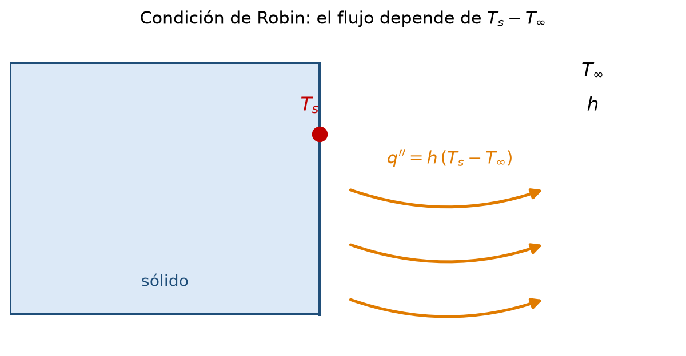

donde:

- $h$ = coeficiente convectivo;
- $T_s$ = temperatura superficial;
- $T_\infty$ = temperatura del ambiente.

La diferencia conceptual con Dirichlet es enorme.

Con Dirichlet:

$$
T_s=T_\infty
$$

Con Robin:

$$
q''=h(T_s-T_\infty)
$$

La superficie **puede estar bastante más caliente o más fría que el aire**.

---

# 12. Ejemplo 1D con Robin

Tomemos una losa inicialmente a $70^\circ$C expuesta por ambos lados a aire a $20^\circ$C.

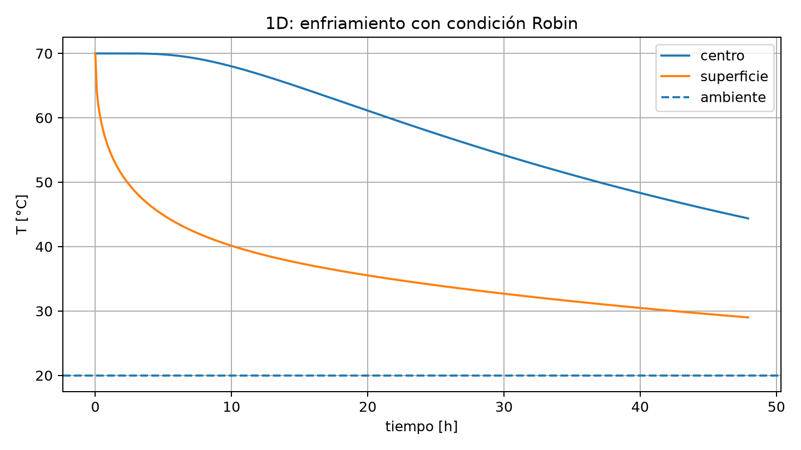

Observa:

- la superficie responde antes;
- el centro responde lentamente;
- aparece un diferencial centro-superficie.

Ese es exactamente uno de los mecanismos relevantes para hormigón masivo.

## Código

```python
import numpy as np
import matplotlib.pyplot as plt
from pathlib import Path

ROOT = Path(__file__).resolve().parents[1]
FIG = ROOT / "images"   # figuras que se insertan en esta guía
OUT = ROOT / "output"   # campos y datos guardados
FIG.mkdir(exist_ok=True)
OUT.mkdir(exist_ok=True)

# Losa 1D inicialmente caliente, expuesta por ambos extremos a convección.
L = 1.0             # m
k = 2.0             # W/(m K)
rho = 2400.0        # kg/m^3
cp = 900.0          # J/(kg K)
alpha = k/(rho*cp)

h = 12.0            # W/(m^2 K)
Tinf = 20.0         # °C

nx = 81
x = np.linspace(0.0, L, nx)
dx = x[1]-x[0]

# Paso estable conservador.
dt_diff = 0.40*dx**2/alpha
dt_conv = 0.40*(rho*cp*dx)/(2*h)
dt = min(dt_diff, dt_conv)

t_end = 48*3600.0
nsteps = int(np.ceil(t_end/dt))
dt = t_end/nsteps
r = alpha*dt/dx**2

T = np.full(nx, 70.0)

times = []
Tcenter = []
Tsurface = []

for n in range(nsteps+1):
    if n % max(1, nsteps//400) == 0:
        times.append(n*dt/3600.0)
        Tcenter.append(T[nx//2])
        Tsurface.append(T[0])

    if n == nsteps:
        break

    Told = T.copy()

    T[1:-1] = Told[1:-1] + r*(
        Told[2:] - 2*Told[1:-1] + Told[:-2]
    )

    # Balance sobre medio volumen de control en cada borde.
    T[0] = Told[0] + dt * (
        2*k/(rho*cp*dx**2) * (Told[1]-Told[0])
        + 2*h/(rho*cp*dx) * (Tinf-Told[0])
    )

    T[-1] = Told[-1] + dt * (
        2*k/(rho*cp*dx**2) * (Told[-2]-Told[-1])
        + 2*h/(rho*cp*dx) * (Tinf-Told[-1])
    )

plt.figure(figsize=(8,4.5))
plt.plot(times, Tcenter, label="centro")
plt.plot(times, Tsurface, label="superficie")
plt.axhline(Tinf, linestyle="--", label="ambiente")
plt.xlabel("tiempo [h]")
plt.ylabel("T [°C]")
plt.title("1D: enfriamiento con condición Robin")
plt.legend()
plt.grid(True)
plt.tight_layout()
plt.savefig(FIG/"03_1d_robin.png", dpi=180)
plt.close()
```

---

# 13. Una condición de borde es una hipótesis física

Siempre preguntar:

1. ¿Qué mecanismo representa?
2. ¿Qué parámetro controla ese mecanismo?
3. ¿Qué unidad tiene?
4. ¿Qué incertidumbre posee?
5. ¿El resultado relevante es sensible a esa hipótesis?

En hormigón masivo, las condiciones de borde superficiales pueden controlar fuertemente el diferencial térmico.

---

# 14. Difusión en 2D

En dos dimensiones:

$$
\frac{\partial T}{\partial t}
=
\alpha
\left(
\frac{\partial^2T}{\partial x^2}
+
\frac{\partial^2T}{\partial y^2}
\right)
+
\frac{\dot q}{\rho c_p}
$$

El stencil cartesiano es:

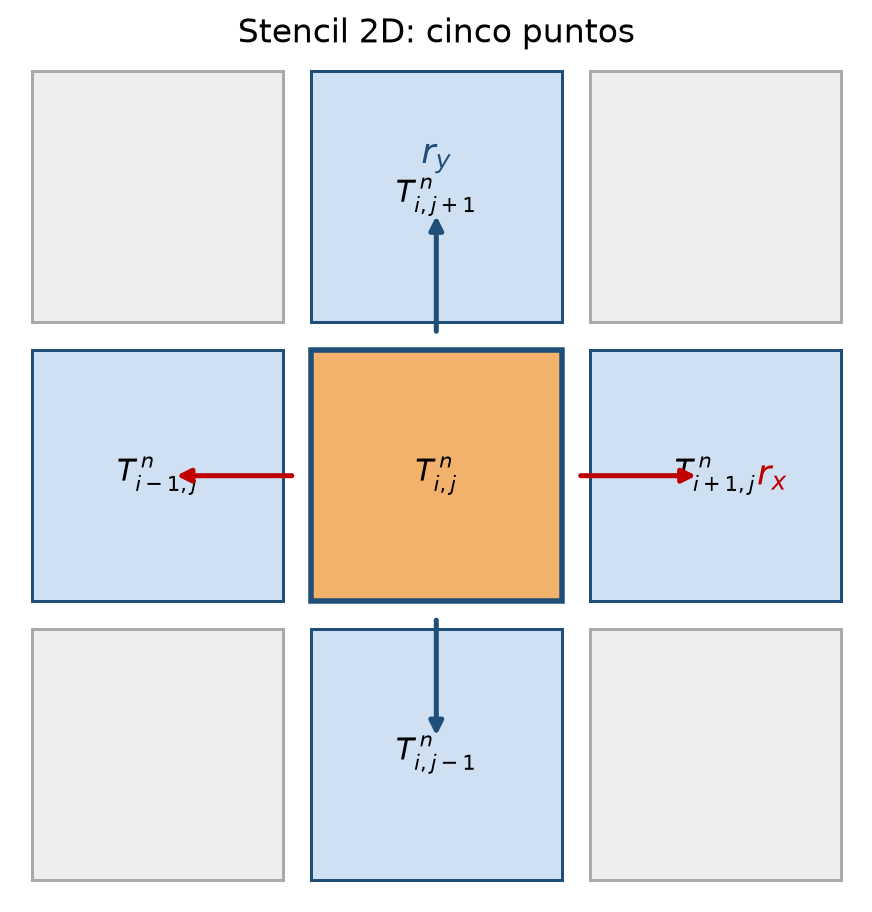

Para $\dot q=0$:

$$
T_{i,j}^{n+1}
=
T_{i,j}^n
+
r_x
\left(
T_{i+1,j}^n-2T_{i,j}^n+T_{i-1,j}^n
\right)
+
r_y
\left(
T_{i,j+1}^n-2T_{i,j}^n+T_{i,j-1}^n
\right)
$$

con:

$$
r_x=\frac{\alpha\Delta t}{\Delta x^2},
\qquad
r_y=\frac{\alpha\Delta t}{\Delta y^2}
$$

---

# 15. Estabilidad en 2D

La condición explícita es:

$$
\boxed{r_x+r_y\le\frac12}
$$

Si:

$$
\Delta x=\Delta y
$$

entonces:

$$
r\le\frac14
$$

---

# 16. Verificación 2D

Usamos:

$$
T(x,y,0)
=
T_0+
A
\sin\left(\frac{\pi x}{L_x}\right)
\sin\left(\frac{\pi y}{L_y}\right)
$$

con $T=T_0$ en todo el contorno.

La solución exacta es:

$$
T(x,y,t)
=
T_0+
A
\sin\left(\frac{\pi x}{L_x}\right)
\sin\left(\frac{\pi y}{L_y}\right)
e^{-\alpha\lambda t}
$$

donde:

$$
\lambda
=
\left(\frac{\pi}{L_x}\right)^2
+
\left(\frac{\pi}{L_y}\right)^2
$$

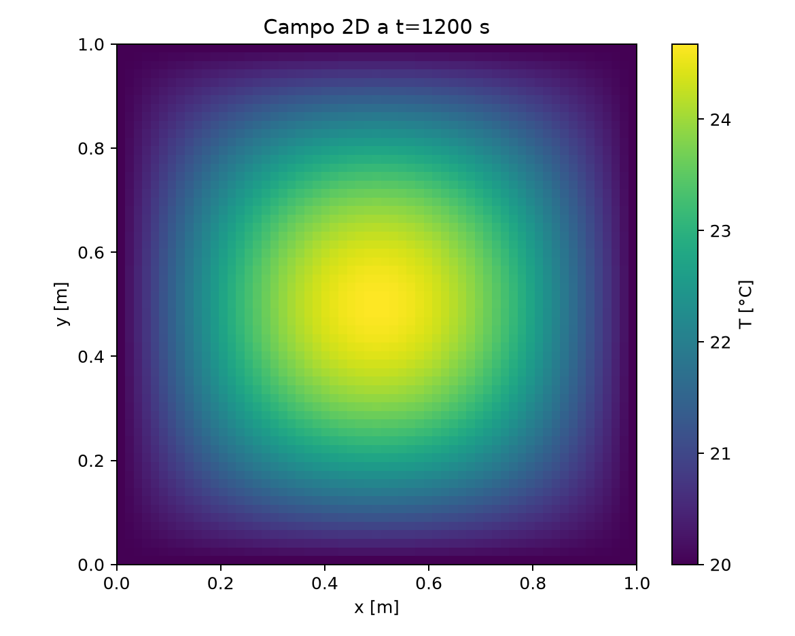

## Código

```python
import numpy as np
import matplotlib.pyplot as plt
from pathlib import Path

ROOT = Path(__file__).resolve().parents[1]
FIG = ROOT / "images"   # figuras que se insertan en esta guía
OUT = ROOT / "output"   # campos y datos guardados
FIG.mkdir(exist_ok=True)
OUT.mkdir(exist_ok=True)

Lx = Ly = 1.0
alpha = 1.0e-4
T0 = 20.0
A = 50.0

nx = ny = 61
x = np.linspace(0, Lx, nx)
y = np.linspace(0, Ly, ny)
dx = x[1]-x[0]
dy = y[1]-y[0]
X, Y = np.meshgrid(x, y, indexing="ij")

# Estabilidad: rx + ry <= 1/2
dt = 0.45 / (alpha*(1/dx**2 + 1/dy**2))
t_end = 1200.0
nsteps = int(np.ceil(t_end/dt))
dt = t_end/nsteps
rx = alpha*dt/dx**2
ry = alpha*dt/dy**2

T = T0 + A*np.sin(np.pi*X/Lx)*np.sin(np.pi*Y/Ly)

T[0,:] = T0
T[-1,:] = T0
T[:,0] = T0
T[:,-1] = T0

for _ in range(nsteps):
    Told = T.copy()
    T[1:-1,1:-1] = Told[1:-1,1:-1] + \
        rx*(Told[2:,1:-1]-2*Told[1:-1,1:-1]+Told[:-2,1:-1]) + \
        ry*(Told[1:-1,2:]-2*Told[1:-1,1:-1]+Told[1:-1,:-2])

    T[0,:] = T0
    T[-1,:] = T0
    T[:,0] = T0
    T[:,-1] = T0

lam = (np.pi/Lx)**2 + (np.pi/Ly)**2
Texact = T0 + A*np.sin(np.pi*X/Lx)*np.sin(np.pi*Y/Ly)*np.exp(-alpha*lam*t_end)

err_inf = np.max(np.abs(T-Texact))
print(f"rx + ry = {rx+ry:.5f}")
print(f"Error L_inf = {err_inf:.6e} °C")

plt.figure(figsize=(6.5,5.2))
im = plt.imshow(T.T, origin="lower", extent=[0,Lx,0,Ly], aspect="equal")
plt.colorbar(im, label="T [°C]")
plt.xlabel("x [m]")
plt.ylabel("y [m]")
plt.title(f"Campo 2D a t={t_end:.0f} s")
plt.tight_layout()
plt.savefig(FIG/"05_2d_dirichlet.png", dpi=180)
plt.close()
```

## Preguntas

- ¿Dónde está el máximo?
- ¿Por qué permanece en el centro?
- ¿Qué ocurre al duplicar $n_x$ y $n_y$?
- ¿Cómo escala el costo de memoria?
- ¿Cómo cambia el paso de tiempo estable?

---

# 17. Difusión en 3D

En tres dimensiones:

$$
\frac{\partial T}{\partial t}
=
\alpha
\left(
\frac{\partial^2T}{\partial x^2}
+
\frac{\partial^2T}{\partial y^2}
+
\frac{\partial^2T}{\partial z^2}
\right)
+
\frac{\dot q}{\rho c_p}
$$

El stencil usa seis vecinos:

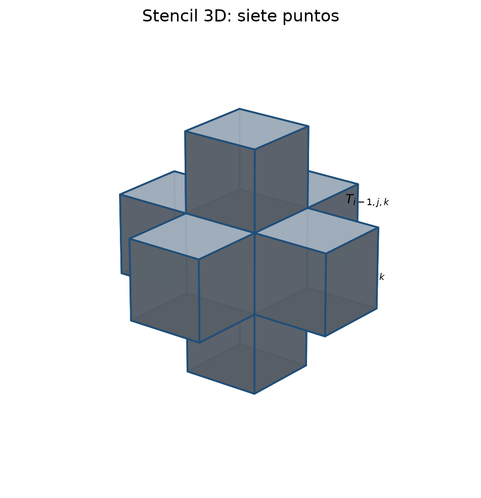

El update explícito puede escribirse como:

$$
T_{i,j,k}^{n+1}
=
T_{i,j,k}^n
+
r_x\delta_{xx}T
+
r_y\delta_{yy}T
+
r_z\delta_{zz}T
+
\frac{\Delta t}{\rho c_p}\dot q
$$

donde:

$$
\delta_{xx}T
=
T_{i+1,j,k}
-2T_{i,j,k}
+T_{i-1,j,k}
$$

y análogamente para $y$ y $z$.

---

# 18. Estabilidad en 3D

La condición es:

$$
\boxed{r_x+r_y+r_z\le\frac12}
$$

Para una grilla cúbica:

$$
\Delta x=\Delta y=\Delta z
$$

entonces:

$$
\boxed{r\le\frac16}
$$

En 3D ocurre simultáneamente:

- muchas más celdas;
- paso estable más restrictivo;
- muchas realizaciones Monte Carlo en el proyecto final.

Aquí aparece una razón real para HPC.

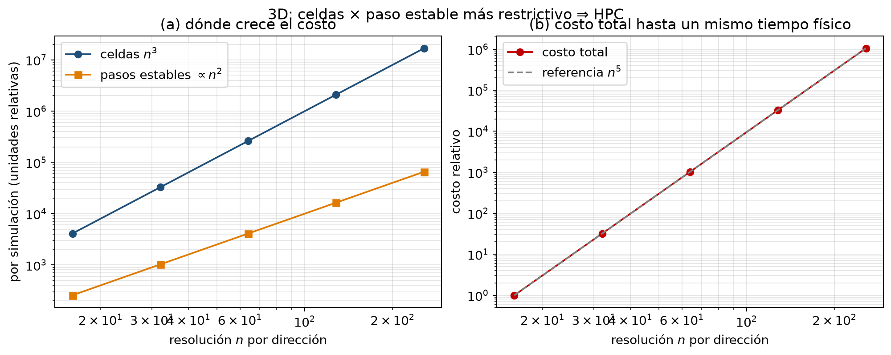

---

# 19. Verificación 3D

Tomamos:

$$
T(x,y,z,0)
=
T_0+
A
\sin\left(\frac{\pi x}{L_x}\right)
\sin\left(\frac{\pi y}{L_y}\right)
\sin\left(\frac{\pi z}{L_z}\right)
$$

con $T=T_0$ en las seis caras.

La solución exacta es:

$$
T(x,y,z,t)
=
T_0+
A
\sin\left(\frac{\pi x}{L_x}\right)
\sin\left(\frac{\pi y}{L_y}\right)
\sin\left(\frac{\pi z}{L_z}\right)
e^{-\alpha\lambda t}
$$

con:

$$
\lambda
=
\left(\frac{\pi}{L_x}\right)^2+
\left(\frac{\pi}{L_y}\right)^2+
\left(\frac{\pi}{L_z}\right)^2
$$

La figura muestra un corte por el plano medio:

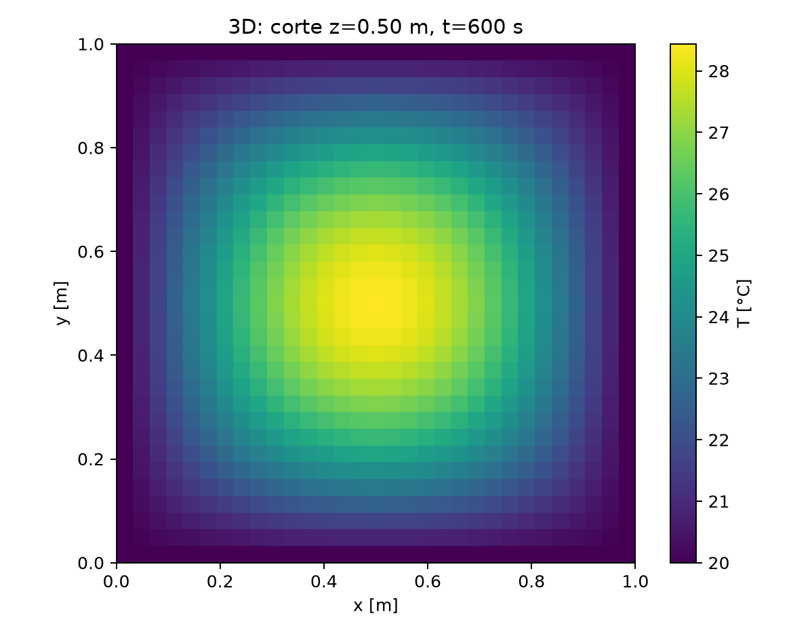

## Código

```python
import numpy as np
import matplotlib.pyplot as plt
from pathlib import Path

ROOT = Path(__file__).resolve().parents[1]
FIG = ROOT / "images"   # figuras que se insertan en esta guía
OUT = ROOT / "output"   # campos y datos guardados
FIG.mkdir(exist_ok=True)
OUT.mkdir(exist_ok=True)

Lx = Ly = Lz = 1.0
alpha = 1.0e-4
T0 = 20.0
A = 50.0

nx = ny = nz = 31
x = np.linspace(0,Lx,nx)
y = np.linspace(0,Ly,ny)
z = np.linspace(0,Lz,nz)
dx = x[1]-x[0]
dy = y[1]-y[0]
dz = z[1]-z[0]
X,Y,Z = np.meshgrid(x,y,z,indexing="ij")

# Estabilidad: rx + ry + rz <= 1/2
dt = 0.45 / (alpha*(1/dx**2 + 1/dy**2 + 1/dz**2))
t_end = 600.0
nsteps = int(np.ceil(t_end/dt))
dt = t_end/nsteps
rx = alpha*dt/dx**2
ry = alpha*dt/dy**2
rz = alpha*dt/dz**2

T = T0 + A * \
    np.sin(np.pi*X/Lx) * \
    np.sin(np.pi*Y/Ly) * \
    np.sin(np.pi*Z/Lz)

def apply_bc(T):
    T[0,:,:] = T0
    T[-1,:,:] = T0
    T[:,0,:] = T0
    T[:,-1,:] = T0
    T[:,:,0] = T0
    T[:,:,-1] = T0

apply_bc(T)

for _ in range(nsteps):
    Told = T.copy()
    T[1:-1,1:-1,1:-1] = Told[1:-1,1:-1,1:-1] + \
        rx*(Told[2:,1:-1,1:-1]-2*Told[1:-1,1:-1,1:-1]+Told[:-2,1:-1,1:-1]) + \
        ry*(Told[1:-1,2:,1:-1]-2*Told[1:-1,1:-1,1:-1]+Told[1:-1,:-2,1:-1]) + \
        rz*(Told[1:-1,1:-1,2:]-2*Told[1:-1,1:-1,1:-1]+Told[1:-1,1:-1,:-2])
    apply_bc(T)

lam = (np.pi/Lx)**2 + (np.pi/Ly)**2 + (np.pi/Lz)**2
Texact = T0 + A * \
    np.sin(np.pi*X/Lx) * \
    np.sin(np.pi*Y/Ly) * \
    np.sin(np.pi*Z/Lz) * np.exp(-alpha*lam*t_end)

err_inf = np.max(np.abs(T-Texact))
print(f"rx + ry + rz = {rx+ry+rz:.5f}")
print(f"Error L_inf = {err_inf:.6e} °C")

k = nz//2
plt.figure(figsize=(6.5,5.2))
im = plt.imshow(T[:,:,k].T, origin="lower", extent=[0,Lx,0,Ly], aspect="equal")
plt.colorbar(im, label="T [°C]")
plt.xlabel("x [m]")
plt.ylabel("y [m]")
plt.title(f"3D: corte z={z[k]:.2f} m, t={t_end:.0f} s")
plt.tight_layout()
plt.savefig(FIG/"06_3d_midplane.png", dpi=180)
plt.close()

np.savez_compressed(OUT/"06_3d_field.npz", x=x, y=y, z=z, T=T)
```

---

# 20. Visualización 3D: PyVista

Para debugging numérico, un corte 2D con Matplotlib es muy útil.

Para explorar el campo completo conviene usar PyVista/VTK o ParaView.

## Código PyVista

```python
"""
Visualización 3D con PyVista.

Instalar:
    pip install pyvista

Primero ejecutar:
    python 06_3d_dirichlet_verification.py

Por defecto guarda una captura estática en:
    images/15_pyvista_slices.png
Con `--interactive` abre la ventana interactiva y espera al usuario:

    python 10_pyvista_3d.py --interactive
"""
import sys
from pathlib import Path

import numpy as np
import pyvista as pv

ROOT = Path(__file__).resolve().parents[1]
data = np.load(ROOT/"output"/"06_3d_field.npz")

x = data["x"]
y = data["y"]
z = data["z"]
T = data["T"]

dx = x[1]-x[0]
dy = y[1]-y[0]
dz = z[1]-z[0]

grid = pv.ImageData(
    dimensions=T.shape,
    spacing=(dx,dy,dz),
    origin=(x[0],y[0],z[0]),
)
grid.point_data["T"] = T.ravel(order="F")

# Captura estática para esta guía (funciona sin pantalla)
pl = pv.Plotter(off_screen=True)
pl.add_mesh(grid.slice_orthogonal(), scalars="T", cmap="inferno",
            show_edges=True)
pl.add_axes()
pl.add_text("3D: cortes ortogonales del campo de temperatura",
            font_size=12)
pl.screenshot(ROOT/"images"/"15_pyvista_slices.png")
pl.close()

# Cortes ortogonales interactivos (sólo con --interactive)
if "--interactive" in sys.argv:
    p = pv.Plotter()
    p.add_mesh(grid.slice_orthogonal(), scalars="T", cmap="inferno",
               show_edges=True)
    p.add_axes()
    p.show()
```

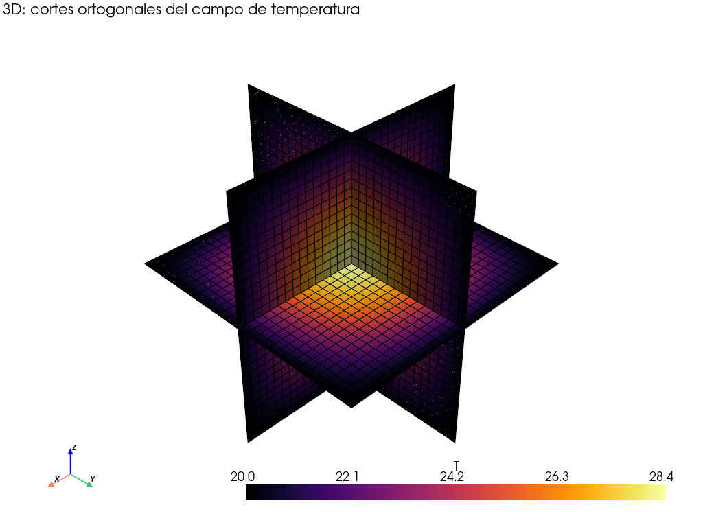

Con esto puedes:

- hacer slices;
- clipping;
- isosuperficies;
- animación;
- inspección interactiva.

Para el proyecto:

| Herramienta | Uso |
|---|---|
| Matplotlib | curvas, convergencia, histogramas, tests |
| PyVista | 3D programático |
| ParaView | postproceso interactivo y series temporales |

---

# 21. Fuente volumétrica de calor

La ecuación general contiene:

$$
\dot q
$$

con unidades:

$$
[\dot q]=\mathrm{W/m^3}
$$

En un dominio adiabático y uniforme:

$$
\rho c_p\frac{dT}{dt}=\dot q
$$

Si $\dot q$ es constante:

$$
T(t)
=
T_0+
\frac{\dot q}{\rho c_p}t
$$

Este caso es un test excelente.

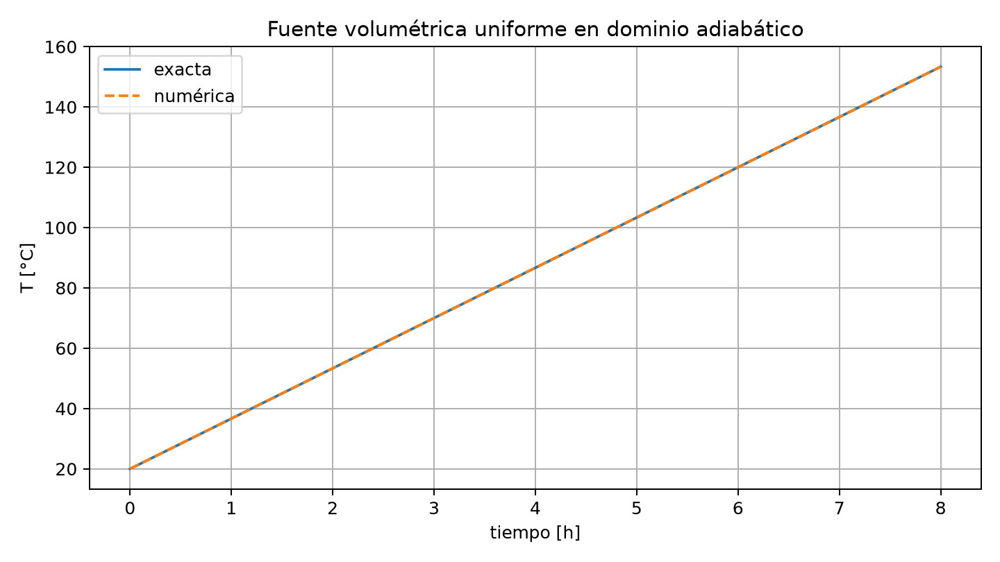

## Código

```python
import numpy as np
import matplotlib.pyplot as plt
from pathlib import Path

ROOT = Path(__file__).resolve().parents[1]
FIG = ROOT / "images"   # figuras que se insertan en esta guía
OUT = ROOT / "output"   # campos y datos guardados
FIG.mkdir(exist_ok=True)
OUT.mkdir(exist_ok=True)

rho = 2400.0       # kg/m^3
cp = 900.0         # J/(kg K)
qdot = 10000.0     # W/m^3
T0 = 20.0          # °C

t_end = 8*3600.0
dt = 60.0
t = np.arange(0.0, t_end+dt, dt)

T_exact = T0 + qdot/(rho*cp)*t

T = np.empty_like(t)
T[0] = T0
for n in range(len(t)-1):
    T[n+1] = T[n] + dt*qdot/(rho*cp)

print("Error máximo:", np.max(np.abs(T-T_exact)))

plt.figure(figsize=(8,4.5))
plt.plot(t/3600.0, T_exact, label="exacta")
plt.plot(t/3600.0, T, "--", label="numérica")
plt.xlabel("tiempo [h]")
plt.ylabel("T [°C]")
plt.title("Fuente volumétrica uniforme en dominio adiabático")
plt.legend()
plt.grid(True)
plt.tight_layout()
plt.savefig(FIG/"07_uniform_source.png", dpi=180)
plt.close()
```

---

# 22. Conservación de energía

En un dominio completamente adiabático y sin fuente:

$$
\dot q=0
$$

y:

$$
q_n''=0
$$

la energía térmica total debe permanecer constante:

$$
E(t)
=
\sum_i
\rho_i c_{p,i}V_iT_i
$$

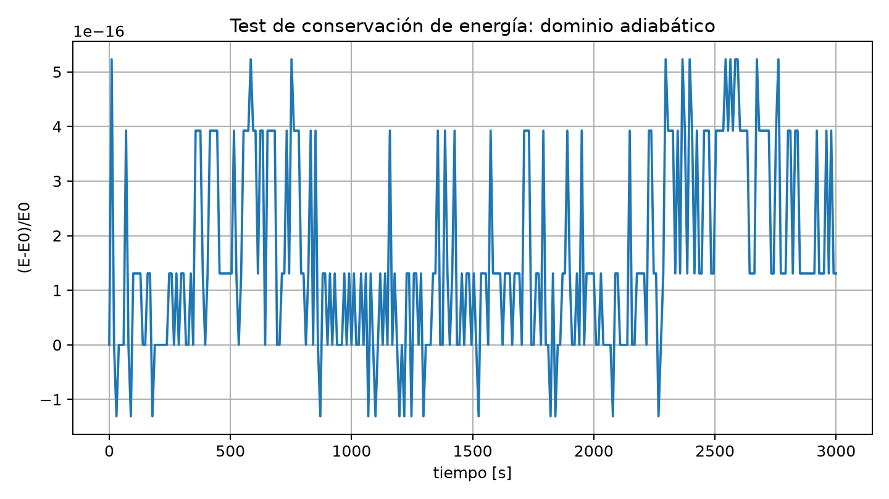

## Código

```python
import numpy as np
import matplotlib.pyplot as plt
from pathlib import Path

ROOT = Path(__file__).resolve().parents[1]
FIG = ROOT / "images"   # figuras que se insertan en esta guía
OUT = ROOT / "output"   # campos y datos guardados
FIG.mkdir(exist_ok=True)
OUT.mkdir(exist_ok=True)

L = 1.0
alpha = 1.0e-4
rho = 2400.0
cp = 900.0

nx = 101
x = np.linspace(0,L,nx)
dx = x[1]-x[0]

dt = 0.45*dx**2/alpha
t_end = 3000.0
nsteps = int(np.ceil(t_end/dt))
dt = t_end/nsteps
r = alpha*dt/dx**2

# Perfil inicial arbitrario
T = 20.0 + 30.0*np.exp(-((x-0.35)/0.12)**2)

# Pesos de volumen de control:
# borde = medio volumen; interior = volumen completo.
weights = np.ones(nx)
weights[0] = weights[-1] = 0.5

def energy(T):
    return rho*cp*dx*np.sum(weights*T)

E0 = energy(T)
times = [0.0]
relerr = [0.0]

for n in range(1,nsteps+1):
    Told=T.copy()

    T[1:-1]=Told[1:-1]+r*(Told[2:]-2*Told[1:-1]+Told[:-2])

    # Ambos extremos adiabáticos
    T[0]=Told[0]+2*r*(Told[1]-Told[0])
    T[-1]=Told[-1]+2*r*(Told[-2]-Told[-1])

    if n % max(1,nsteps//300) == 0:
        times.append(n*dt)
        relerr.append((energy(T)-E0)/E0)

plt.figure(figsize=(8,4.5))
plt.plot(np.array(times), np.array(relerr))
plt.xlabel("tiempo [s]")
plt.ylabel("(E-E0)/E0")
plt.title("Test de conservación de energía: dominio adiabático")
plt.grid(True)
plt.tight_layout()
plt.savefig(FIG/"08_energy_conservation.png", dpi=180)
plt.close()

print("Error relativo final de energía:", (energy(T)-E0)/E0)
```

Este test es especialmente poderoso porque puede detectar errores de borde que un gráfico de temperatura no revela fácilmente.

---

# 23. De curva adiabática a calor de hidratación

En hormigón masivo suele ser más útil medir o modelar una **elevación adiabática de temperatura**:

$$
\theta_{ad}(t)
$$

Bajo condición adiabática:

$$
\rho c_p
\frac{d\theta_{ad}}{dt}
=
\dot q_h(t)
$$

por lo tanto:

$$
\boxed{
\dot q_h(t)
=
\rho c_p
\frac{d\theta_{ad}}{dt}
}
$$

Esto conecta directamente un ensayo/curva de hidratación con el término fuente del solver.

---

# 24. Ejemplo pedagógico de hidratación

Supongamos:

$$
\theta_{ad}(t)
=
\theta_\infty
\left(
1-e^{-t/\tau}
\right)
$$

Entonces:

$$
\frac{d\theta_{ad}}{dt}
=
\frac{\theta_\infty}{\tau}
e^{-t/\tau}
$$

y:

$$
\dot q_h(t)
=
\rho c_p
\frac{\theta_\infty}{\tau}
e^{-t/\tau}
$$

Elevación acumulada:

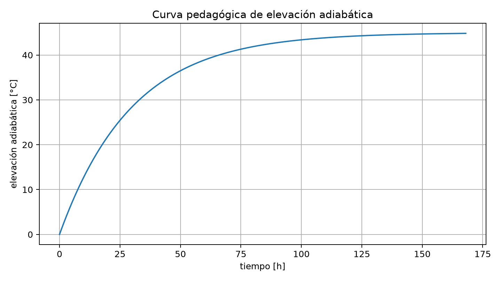

Fuente instantánea:

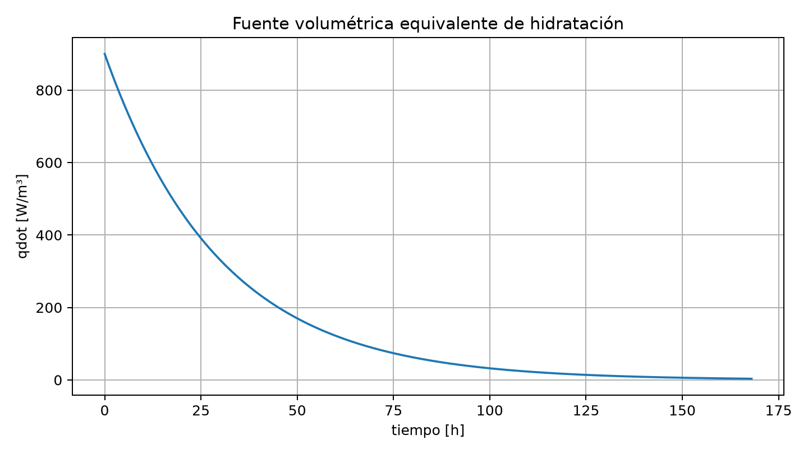

## Código

```python
import numpy as np
import matplotlib.pyplot as plt
from pathlib import Path

ROOT = Path(__file__).resolve().parents[1]
FIG = ROOT / "images"   # figuras que se insertan en esta guía
OUT = ROOT / "output"   # campos y datos guardados
FIG.mkdir(exist_ok=True)
OUT.mkdir(exist_ok=True)

rho = 2400.0       # kg/m^3
cp = 900.0         # J/(kg K)

theta_inf = 45.0   # °C de elevación adiabática final
tau = 30.0*3600.0  # s

t = np.linspace(0, 7*24*3600.0, 1000)

theta = theta_inf*(1.0 - np.exp(-t/tau))

# qdot = rho*cp*d(theta)/dt
qdot = rho*cp*(theta_inf/tau)*np.exp(-t/tau)

plt.figure(figsize=(8,4.5))
plt.plot(t/3600.0, theta)
plt.xlabel("tiempo [h]")
plt.ylabel("elevación adiabática [°C]")
plt.title("Curva pedagógica de elevación adiabática")
plt.grid(True)
plt.tight_layout()
plt.savefig(FIG/"09_adiabatic_rise.png", dpi=180)
plt.close()

plt.figure(figsize=(8,4.5))
plt.plot(t/3600.0, qdot)
plt.xlabel("tiempo [h]")
plt.ylabel("qdot [W/m³]")
plt.title("Fuente volumétrica equivalente de hidratación")
plt.grid(True)
plt.tight_layout()
plt.savefig(FIG/"10_hydration_source.png", dpi=180)
plt.close()
```

### No confundir

$\theta_{ad}$ es una **elevación acumulada de temperatura**.

$\dot q_h$ es una **tasa de generación de energía por volumen**.

No tienen las mismas unidades.

---

# 25. Temperatura y cinética de hidratación

El ejemplo anterior depende sólo de $t$.

Un modelo más realista puede escribirse como:

$$
\dot q_h
=
\dot q_h(t,T,\alpha_h,\ldots)
$$

La velocidad de hidratación depende de la historia térmica.

Una estrategia habitual es usar **edad equivalente** o una cinética tipo Arrhenius.

En el proyecto, eso debe venir **después** de haber verificado:

```text
difusión
  ↓
fuente volumétrica
  ↓
hidratación simple
  ↓
dependencia con temperatura
```

---

# 26. Formulación por balance de voxel

Para geometría compleja, una forma muy clara de programar es:

$$
C_i\frac{dT_i}{dt}
=
\sum_jG_{ij}(T_j-T_i)
+
\dot q_iV_i
+
Q_{b,i}
$$

con:

$$
C_i=\rho_i c_{p,i}V_i
$$

y:

$$
G_{ij}
=
\frac{k_{ij}A_{ij}}{d_{ij}}
$$

Esta forma es muy cercana a un **volumen finito cartesiano**.

Ventajas:

- física transparente;
- distintos materiales;
- interfaces;
- voxeles activos/inactivos;
- condiciones de borde mediante conductancias.

---

# 27. Interfaz entre materiales

Si dos celdas del mismo tamaño tienen conductividades distintas, una elección natural para la conductividad efectiva de la cara es la media armónica:

$$
k_{ij}
=
\frac{2k_ik_j}{k_i+k_j}
$$

¿Por qué?

Porque el flujo atraviesa dos medias celdas cuyas **resistencias térmicas están en serie**.

Este principio será importante para interfaces:

- hormigón–suelo;
- vertida nueva–vertida existente;
- hormigón–moldaje;
- aislación.

---

# 28. Robin como red de resistencias

Una celda cuyo centro está a $\Delta x/2$ de la superficie tiene una resistencia conductiva:

$$
R_{cond}
=
\frac{\Delta x/2}{kA}
$$

La convección aporta:

$$
R_{conv}
=
\frac{1}{hA}
$$

Entonces:

$$
Q
=
\frac{T_\infty-T_i}
{R_{cond}+R_{conv}}
$$

Esto es una forma muy conveniente de implementar Robin en un solver por celdas.

---

# 29. Moldaje y aislación

Si existe moldaje o aislación:

$$
R_{tot}
=
\frac{\Delta x/2}{k_hA}
+
R_{moldaje}
+
R_{aislación}
+
\frac{1}{hA}
$$

Por ejemplo:

$$
R_{aislación}
=
\frac{L_{aislación}}{k_{aislación}A}
$$

Finalmente:

$$
Q
=
\frac{T_\infty-T_i}{R_{tot}}
$$

Cuando se retira el moldaje, **cambia la condición de borde en el tiempo**.

Ésta es exactamente una de las decisiones que el planificador de vertidas deberá representar.

---

# 30. Estabilidad desde el balance de energía

Para una celda explícita:

$$
C_i
\frac{T_i^{n+1}-T_i^n}{\Delta t}
=
\sum_jG_{ij}(T_j^n-T_i^n)+\ldots
$$

Una condición práctica es:

$$
\boxed{
\Delta t
\lesssim
\frac{C_i}
{\sum_jG_{ij}+G_{b,i}}
}
$$

Esto generaliza la condición de Fourier cuando aparecen:

- distintos materiales;
- convección;
- suelo;
- resistencias superficiales.

---

# 31. Parámetros térmicos del caso de referencia

El paper de Ju y Lei (2019) utiliza, entre otros, los siguientes parámetros:

| Propiedad | Valor publicado | Valor SI conveniente |
|---|---:|---:|
| $k$ hormigón | 8.0 kJ/(m·h·°C) | ≈ 2.22 W/(m·K) |
| $c_p$ hormigón | 0.97 kJ/(kg·°C) | 970 J/(kg·K) |
| $\rho$ hormigón | 2400 kg/m³ | 2400 kg/m³ |
| $k$ suelo | 5.0 kJ/(m·h·°C) | ≈ 1.39 W/(m·K) |
| $c_p$ suelo | 1.273 kJ/(kg·°C) | 1273 J/(kg·K) |
| $\rho$ suelo | 1800 kg/m³ | 1800 kg/m³ |

Estos valores son buenos para **sanity checks**, no necesariamente como parámetros definitivos de cada mezcla del proyecto.

Con los valores del hormigón:

$$
\alpha
=
\frac{2.22}
{2400\times970}
\approx
9.5\times10^{-7}\;\mathrm{m^2/s}
$$

---

# 32. Verificación y validación

## Verificación

Pregunta:

> **¿Estoy resolviendo correctamente las ecuaciones que escribí?**

Ejemplos:

- solución exacta;
- convergencia;
- conservación de energía;
- fuente uniforme.

## Validación

Pregunta:

> **¿Las ecuaciones representan adecuadamente la realidad?**

Ejemplos:

- sensores;
- calorimetría;
- curvas del paper;
- monitoreo real.

Puedes tener un código perfectamente verificado y un modelo físicamente malo.

---

# 33. Batería mínima de tests

Antes de simular la fundación:

```text
tests/
├── test_1d_exact.py
├── test_2d_exact.py
├── test_3d_exact.py
├── test_adiabatic_energy.py
├── test_uniform_source.py
├── test_neumann.py
└── test_robin.py
```

## Test 1 — 1D exacto

Debe mostrar convergencia.

## Test 2 — 2D exacto

Debe demostrar que el stencil 2D funciona.

## Test 3 — 3D exacto

Debe demostrar que el stencil 3D funciona.

## Test 4 — energía adiabática

$$
E(t)=\text{constante}
$$

## Test 5 — fuente uniforme

$$
\frac{dT}{dt}
=
\frac{\dot q}{\rho c_p}
$$

## Test 6 — Neumann

Una superficie adiabática no debe perder calor.

## Test 7 — Robin

El flujo debe tener sentido físico respecto de $T_s-T_\infty$.

---

# 34. Errores comunes

## 34.1 Signo incorrecto

Una superficie caliente expuesta a aire frío no debería ganar calor por convección.

---

## 34.2 Mezclar unidades

Ejemplo peligroso:

- $k$ en W/(m·K);
- $c_p$ en kJ/(kg·K);
- tiempo en horas;
- $\dot q$ en W/m³.

Antes de ejecutar, escribe las unidades de cada término.

---

## 34.3 Imponer $T_{aire}$ como Dirichlet

Hacer:

```python
T_surface = T_air
```

equivale a una transferencia superficial infinitamente eficiente.

En una superficie real suele corresponder Robin.

---

## 34.4 Violar estabilidad

Una solución puede volverse oscilatoria antes de “explotar”.

Temperaturas absurdas, overshoot o patrones checkerboard son señales de alarma.

---

## 34.5 Ajustar el paper antes de verificar

No calibres parámetros para obtener 73 °C antes de demostrar que el solver pasa los tests básicos.

---

## 34.6 Confundir energía y potencia

Energía:

$$
Q\;[J]
$$

Potencia:

$$
\dot Q\;[W]
$$

Fuente volumétrica:

$$
\dot q\;[W/m^3]
$$

Flujo superficial:

$$
q''\;[W/m^2]
$$

---

# 35. Ejercicios sugeridos

## Ejercicio A — difusividad

Duplica $\alpha$ en el caso 1D.

Pregunta:

> ¿Cambia el estado estacionario? ¿Cambia la velocidad con que se alcanza?

---

## Ejercicio B — estabilidad

En el script 1D fuerza:

$$
r=0.55
$$

Observa la solución.

Luego prueba:

$$
r=0.8
$$

¿Qué patrón aparece?

Pista: la respuesta está en la figura de la sección 6 (`code/11_extra_figures.py` genera ese experimento exacto).

---

## Ejercicio C — Robin

En el ejemplo convectivo prueba:

```text
h = 5
h = 20
h = 100 W/(m² K)
```

Pregunta:

> ¿Cómo cambia el diferencial centro-superficie?

---

## Ejercicio D — escala geométrica

Mantén propiedades y duplica $L$.

Pregunta:

> ¿Por qué el tiempo característico crece aproximadamente con $L^2$?

---

## Ejercicio E — 2D versus 1D

Construye una placa donde una dimensión sea mucho mayor que la otra.

Pregunta:

> ¿Cuándo parece razonable aproximarla como problema 1D?

---

## Ejercicio F — fuente interna

En el caso adiabático duplica $\dot q$.

Pregunta:

> ¿Qué cantidad debería duplicarse exactamente?

---

# 36. De esta guía al capstone

El flujo del proyecto será:

```text
problemas 1D verificables
        ↓
2D verificable
        ↓
3D verificable
        ↓
voxelización de geometría BIM
        ↓
fuente de hidratación
        ↓
vertidas activadas en distintos tiempos
        ↓
moldaje / aislación / suelo
        ↓
clima real
        ↓
Monte Carlo
        ↓
decisión constructiva
```

La regla central es:

> **La complejidad se agrega después de verificar la capa anterior.**

---

# 37. Referencias

## Hormigón masivo

- Instituto del Cemento y del Hormigón de Chile (ICH), **Especificación para Hormigón Masivo Estructural**, Santiago, 2019. En particular:
  - requisitos de temperatura;
  - Plan de Control de Temperatura;
  - Anexo 4 sobre métodos de estimación;
  - Método de Schmidt como método simplificado de diferencias finitas.

- Ju, Y. & Lei, H. (2019), **Actual Temperature Evolution of Thick Raft Concrete Foundations and Cracking Risk Analysis**, *Advances in Materials Science and Engineering*, Article ID 7029671.

## Transferencia de calor

- Incropera, DeWitt, Bergman & Lavine, *Fundamentals of Heat and Mass Transfer*.
- Çengel & Ghajar, *Heat and Mass Transfer: Fundamentals & Applications*.
- Crank, *The Mathematics of Diffusion*.

## Python y visualización

- NumPy: https://numpy.org/doc/
- Matplotlib: https://matplotlib.org/stable/
- PyVista: https://docs.pyvista.org/
- ParaView: https://docs.paraview.org/

---

# 38. Cómo ejecutar los ejemplos

Desde la carpeta de este tutorial:

```bash
python -m venv .venv
source .venv/bin/activate
pip install -r requirements.txt
python code/run_all.py
```

Cada bloque de código de esta guía existe como script independiente en `code/`:

| Script | Figura / salida |
|---|---|
| `code/00_schematic_figures.py` | diagramas: balance, Dirichlet, Neumann, Robin, stencils |
| `code/01_1d_dirichlet_verification.py` | `images/01_1d_dirichlet.png` |
| `code/02_1d_convergence.py` | `images/04_1d_convergence.png` |
| `code/03_1d_neumann.py` | `images/02_1d_neumann.png` |
| `code/04_1d_robin.py` | `images/03_1d_robin.png` |
| `code/05_2d_dirichlet_verification.py` | `images/05_2d_dirichlet.png` |
| `code/06_3d_dirichlet_verification.py` | `images/06_3d_midplane.png`, `output/06_3d_field.npz` |
| `code/07_uniform_source.py` | `images/07_uniform_source.png` |
| `code/08_energy_conservation.py` | `images/08_energy_conservation.png` |
| `code/09_hydration_source.py` | `images/09_adiabatic_rise.png`, `images/10_hydration_source.png` |
| `code/10_pyvista_3d.py` | `images/15_pyvista_slices.png` |
| `code/11_extra_figures.py` | figuras complementarias (stencil 1D, estabilidad, Fourier, costo 3D) |

Las figuras se escriben en:

```text
images/
```

y los campos/datos guardados en:

```text
output/
```

Para visualización interactiva 3D:

```bash
python code/10_pyvista_3d.py --interactive
```

---

# 39. Checklist antes de avanzar al caso real

- [ ] Puedo explicar la ley de Fourier.
- [ ] Puedo derivar el stencil 1D.
- [ ] Entiendo $\alpha$.
- [ ] Sé verificar estabilidad.
- [ ] Puedo implementar Dirichlet.
- [ ] Puedo implementar Neumann.
- [ ] Puedo implementar Robin.
- [ ] Mi solver pasa el test 1D.
- [ ] Mi solver pasa el test 2D.
- [ ] Mi solver pasa el test 3D.
- [ ] Conserva energía en un dominio adiabático.
- [ ] Responde correctamente a una fuente uniforme.
- [ ] Distingo verificación de validación.
- [ ] Puedo explicar cada unidad del balance térmico.
- [ ] Estoy listo para agregar hidratación y geometría BIM.
