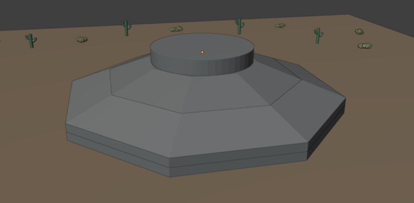

# E06 — Dossier de verificación térmica y BIM

**Equipo:** Grupo 3 — Monserrat Cubillos Tome, Josefina Ignacia Muro Teuber y Vicente Andrés Urmeneta Campos  
**Repositorio:** [vaurmeneta-22/P2-Grupo-3](https://github.com/vaurmeneta-22/P2-Grupo-3)  
**Commit evaluado:** pendiente de completar después del commit final.

## Matriz de verificación

La batería principal se ejecutó con `python .\scripts\run_tests.py`: **46/46 pruebas aprobadas**. El verificador E05 se ejecutó con `python .\scripts\verificar_E05.py` y aprobó los tres casos indicados.

| Test | Qué verifica | Error/métrica | Resultado |
| --- | --- | --- | --- |
| Solución exacta 1D | FTCS frente a un modo sinusoidal analítico, t = 5000 s | Error máximo: 0.003703 °C (21 nodos); 0.000930 °C (41 nodos) | Aprobado; el error baja 3.98× al refinar |
| Solución sinusoidal 2D | Campo numérico frente a solución analítica | Error máximo 0.008633 °C; tolerancia 0.039340 °C | Aprobado |
| Solución sinusoidal 3D | Campo numérico frente a solución analítica | Error máximo 0.017351 °C; tolerancia 0.083606 °C | Aprobado |
| Convergencia espacial 2D | Refinamiento 8², 16² y 32²; t = 1500 s, `dt` pequeño fijo | Errores: 1.19836e-3, 3.00712e-4 y 6.69475e-5 °C; razones 3.99 y 4.49 | Aprobado; orden cercano a 2 |
| Convergencia temporal 2D | Malla 12² fija; comparación con referencia `dt_límite/32` | Errores para `dt_límite`, `/2`, `/4`: 1.84379e-3, 8.84954e-4 y 4.22498e-4 °C; razones 2.08 y 2.09 | Aprobado; orden cercano a 1 |
| Conservación adiabática | Energía total con todas las caras aisladas | 2D: error relativo 4.00e-16; 3D: 0.00 reportado | Aprobado; variación compatible con redondeo |
| Fuente uniforme | Calentamiento y energía para 500 W/m³ en dominio adiabático | Temperatura esperada 25 °C; error T 1.42e-14 °C; energía añadida 1.296000e6 J frente a igual valor esperado; error relativo de energía 4.94e-16 | Aprobado |
| Robin estacionario | Flujo con Dirichlet 50 °C, aire 10 °C, h = 8 W/(m²·K), L = 0.4 m | Flujo analítico 123.076923 W/m²; numérico 123.076923 W/m²; error relativo 1.11e-12 | Aprobado |

La convergencia espacial usa un `dt` fijo pequeño para aislar el error de malla. La convergencia temporal mantiene fija la malla y compara contra una corrida de referencia más fina. Los resultados corresponden al código del árbol de trabajo probado; el SHA definitivo se indicará al cerrar el commit.

## BIM base: dimensiones y figura

El IFC de referencia es `models/ifc/Fundacion_1_con_propiedades.ifc`, esquema IFC4 y unidades SI. La inspección encontró cinco objetos `IfcFooting`; la envolvente global mide **18 × 18 × 4.3 m**. Alturas y cajas envolventes:

| Vertida | Caja envolvente [m] | Volumen IFC triangulado [m³] |
| --- | --- | ---: |
| 01 | 18 × 18 × 0.55 | 147.626 |
| 02 | 18 × 18 × 0.55 | 147.626 |
| 03 | 18 × 18 × 1.10 | 214.224 |
| 04 | 12.5 × 12.5 × 1.10 | 88.925 |
| 05 | 7 × 7 × 1.00 | 38.375 |

Volumen geométrico triangulado total: **636.776 m³**. La Vertida_05 ocupa z = 3.30–4.30 m. Las dimensiones y volúmenes informados proceden del IFC, que es la fuente de referencia del modelo. La imagen muestra la escena Blender/Bonsai como vista visual de la fundación.



## Simplificaciones geométricas declaradas

- La fundación se representa como cinco vertidas idealizadas `IfcFooting`, no como una malla térmica voxelizada.
- Las formas escalonadas y troncopiramidales se aproximan con caras poligonales. La vertida superior cilíndrica está teselada.
- No se modelan armaduras. Moldaje y aislación figuran como `TBD` en las propiedades; no se representan como volúmenes constructivos.
- El suelo, los cactus, la estepa y la iluminación de la escena de presentación no son parte de la geometría IFC de hormigón.
- La inspección calcula cajas y volúmenes de malla; no demuestra ausencia de solapes, vacíos ni valida hermeticidad.
- Las propiedades térmicas y la fuente de los demos son didácticas; el IFC todavía no alimenta el solver.

## Reproducción

Desde la raíz del repositorio, en PowerShell:

```powershell
.\.venv\Scripts\python.exe .\scripts\run_tests.py
.\.venv\Scripts\python.exe .\scripts\verificar_E05.py
.\.venv\Scripts\python.exe .\scripts\inspeccionar_ifc_e04.py .\models\ifc\Fundacion_1_con_propiedades.ifc
```

El IFC está versionado en `models/ifc/`; se puede abrir desde Bonsai con **File → Open IFC Project**. Este dossier debe acompañarse del SHA del commit final que incluya el IFC y la figura.
