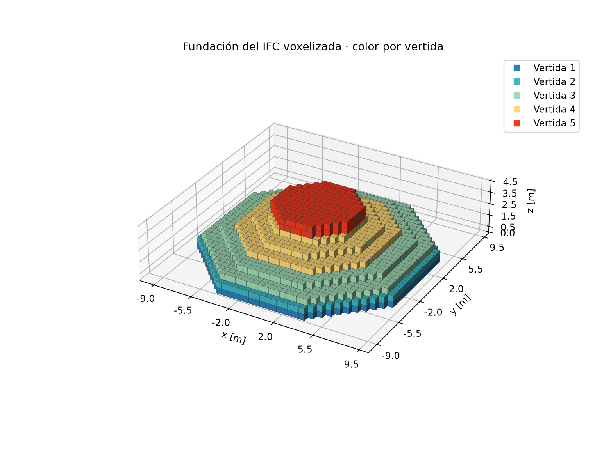
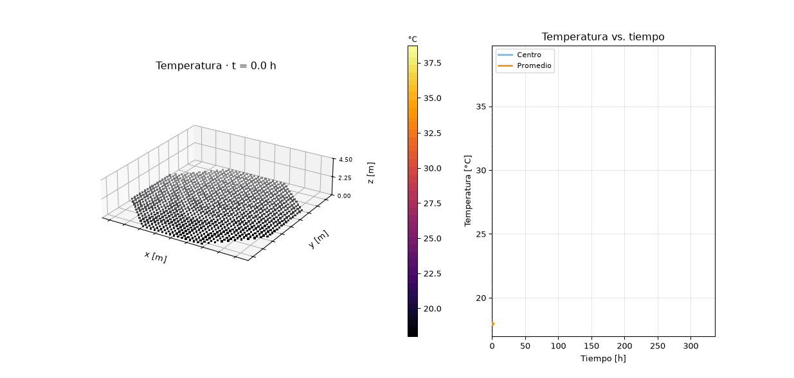

# Reporte Semana 3 — Integración IFC, voxelización y fuente por vertidas

**Proyecto:** Proyecto 2 — Planificación de vertidas de hormigón masivo  
**Equipo:** Grupo 3  
**Integrantes:** Monserrat Cubillos Tome, Josefina Ignacia Muro Teuber y Vicente Andrés Urmeneta Campos  
**Repositorio:** [vaurmeneta-22/P2-Grupo-3](https://github.com/vaurmeneta-22/P2-Grupo-3)  
**Fecha de registro:** 2 de noviembre de 2026  
**Commit de evidencia:** completar al registrar el commit de entrega.

## 1. Objetivo y alcance

En la semana 3 se conectó el modelo IFC de la fundación con el solver térmico 3D ya existente. El flujo extrae las vertidas y sus propiedades, las transforma en una grilla de voxeles, activa cada etapa según su hora de colocación y calcula conducción y generación interna de calor. La secuencia de colocación se lee desde el IFC; no está codificada dentro del solver.

Esta versión es un prototipo demostrativo para estudiar el flujo BIM → IFC → voxelización → solver. Sus propiedades y la fuente térmica aún no están calibradas para una mezcla real, por lo que las temperaturas no deben presentarse como predicción de diseño.

## 2. Archivos principales

| Archivo | Función |
| --- | --- |
| `models/ifc/Fundacion_1_con_propiedades.ifc` | Modelo IFC4 de referencia con cinco objetos `IfcFooting` y propiedades de vertida. |
| `src/mcplan/geometry/ifc.py` | Lectura de geometría IFC y extracción de ID, inicio, temperatura de colocación y material. |
| `src/mcplan/geometry/voxelizacion.py` | Grilla cartesiana y asignación de `vertida_id` a los voxeles. |
| `src/mcplan/thermal/vertidas.py` | Activación por etapas, inicialización de voxeles nuevos y acoplamiento al solver. |
| `src/mcplan/thermal/hidratacion.py` | Modelos de fuente por edad; incluye el pulso cosenoidal usado actualmente. |
| `src/mcplan/thermal/diffusion_nd.py` | Solver cartesiano 3D con difusión, fuentes volumétricas y condiciones de borde. |
| `scripts/demo_pipeline_ifc_3d.py` | Ejecuta la extracción, voxelización, simulación y generación de resultados. |
| `configs/semana3_fundacion.jsonc` | Parámetros editables de grilla, tiempo, materiales, fuente y borde. |

## 3. Geometría BIM y voxelización

El IFC contiene cinco vertidas `IfcFooting`, todas con temperatura de colocación de 18 °C. La altura global del modelo es 4,3 m. La geometría BIM/IFC es la referencia; los siguientes tamaños son las dimensiones de las cajas envolventes reportadas por el inspector IFC.

| ID | Inicio IFC [h] | Dimensiones de caja [m] | Volumen IFC [m³] |
| ---: | ---: | ---: | ---: |
| 1 | 0 | 18 × 18 × 0,55 | 147,626 |
| 2 | 6 | 18 × 18 × 0,55 | 147,626 |
| 3 | 12 | 18 × 18 × 1,10 | 214,224 |
| 4 | 18 | 12,5 × 12,5 × 1,10 | 88,925 |
| 5 | 24 | 7 × 7 × 1,00 | 38,375 |
| **Total IFC** | — | Altura global: **4,30** | **636,775** |

La voxelización clasifica los centros de las celdas con respecto a las mallas trianguladas del IFC. En la corrida principal se usó Δx = 0,5 m, grilla de 37 × 37 × 9 y 5140 voxeles de hormigón. El volumen calculado fue 642,500 m³, con error relativo de 0,899% respecto del IFC. La aproximación de frontera staircase depende de Δx.

La comprobación geométrica del volumen dio:

| Δx [m] | Volumen voxelizado [m³] | Error relativo |
| ---: | ---: | ---: |
| 0,500 | 642,500 | 0,899% |
| 0,250 | 633,375 | 0,534% |
| 0,125 | 633,555 | 0,506% |

El área externa e interfaces entre vertidas se estiman contando caras de voxel; por ello son aproximaciones dependientes de la resolución. Para Δx = 0,5 m el área exterior estimada fue 760,00 m². Las áreas de contacto para los pares (1,2), (2,3), (3,4) y (4,5) fueron 269, 244, 123 y 39 m², respectivamente.



## 4. Modelo térmico y fuente cosenoidal

El balance de cada voxel activo se basa en:

\[
\rho c_p V\frac{dT}{dt}=\sum_f \Phi_f+\dot Q(t)V,
\]

donde \(\Phi_f\) es la potencia que cruza cada cara y \(\dot Q\) es la generación volumétrica en W/m³. Los voxeles vecinos intercambian calor mediante el solver cartesiano; las caras exteriores reciben la condición de borde configurada.

La fuente exponencial de la corrida anterior fue reemplazada en el pipeline por el pulso cosenoidal especificado para el ejercicio:

\[
\dot Q(a)=\begin{cases}
\dfrac{Q_{\max}}{2}\left[1-\cos\left(\dfrac{2\pi a}{\tau}\right)\right], & 0\le a\le\tau,\\
0, & a>\tau,
\end{cases}
\]

con \(a=t-t_i\), edad de la vertida desde su hora de colocación \(t_i\). Para cada vertida, la fuente parte en cero, llega al máximo a las 24 h y vuelve a cero a las 48 h. Los parámetros son `Qmax = 500 W/m³` y `τ = 48 h`, definidos en el JSONC. La función no depende de la temperatura instantánea.

Con \(\rho=2400\,\mathrm{kg/m^3}\) y \(c_p=900\,\mathrm{J/(kg\,K)}\), la integral de un pulso completo equivale a un incremento adiabático ideal de:

\[
\Delta T_{ad}=\frac{Q_{\max}\tau}{2\rho c_p}=20\ ^\circ\mathrm C.
\]

Este valor resulta de los parámetros de referencia y no es una curva calorimétrica medida del hormigón del proyecto.

## 5. Configuración y resultados de la corrida

La configuración usada fue Δx = 0,5 m; horizonte de 336 h (14 días); paso temporal máximo de 600 s con factor de seguridad 0,8; material M1 con \(k=2,0\,\mathrm{W/(m\,K)}\), \(\rho=2400\,\mathrm{kg/m^3}\) y \(c_p=900\,\mathrm{J/(kg\,K)}\). El borde fue Robin en todas las caras exteriores, con aire constante a 20 °C y \(h=8\,\mathrm{W/(m^2\,K)}\). Se guardaron perfiles diarios y el GIF a intervalos de 4 h (85 cuadros).

| Métrica | Resultado |
| --- | ---: |
| Temperatura máxima de los estados muestreados | 38,732 °C a las 64 h |
| Temperatura máxima al final (336 h) | 35,003 °C |
| Temperatura promedio al final | 25,209 °C |
| Energía de activación IFC | 2,498040 × 10¹⁰ J |
| Energía aportada por la fuente | 2,775600 × 10¹⁰ J |
| Energía intercambiada por el borde Robin | −1,775191 × 10¹⁰ J |
| Residuo del balance energético | 3,815 × 10⁻⁶ J |

El signo negativo del término de borde indica pérdida neta de calor hacia el ambiente de referencia. El máximo muestreado ocurre después de los picos individuales de algunas vertidas, por la superposición de pulsos y la difusión entre voxeles. La temperatura no se interpreta como una medición real del hormigón.



## 6. Reproducibilidad y verificación

Desde la raíz del repositorio, con el entorno virtual del proyecto activo:

```powershell
python .\scripts\demo_pipeline_ifc_3d.py
```

La corrida finalizó y generó los archivos bajo `results/semana3/`: convergencia de volumen, geometría voxelizada, campo final, perfiles diarios, GIF, historia CSV y resumen. El residuo energético de la corrida es menor que 4 × 10⁻⁶ J. **No se ejecutó la batería automática de tests después de integrar la fuente cosenoidal**; la corrida y su balance se reportan como evidencia de ejecución, no como sustituto de esos tests.

## 7. Simplificaciones geométricas y físicas

- La fundación se representa sobre una grilla cartesiana; la superficie staircase aproxima las mallas IFC.
- El punto central de cada voxel determina su pertenencia a una vertida; no se calcula fracción de volumen en celdas de frontera.
- Los materiales se representan con propiedades constantes por tipo M1; no se modelan cambios espaciales de propiedades dentro de una vertida.
- La fuente se prescribe como función de la edad de cada vertida. No depende de la temperatura, del grado de hidratación ni de una ley cinética calibrada.
- Robin usa un único aire constante y un único coeficiente en todas las caras exteriores; la base en contacto con terreno también recibe esa condición.
- No se separan suelo, moldaje, aislación, radiación solar, lluvia ni clima variable.
- `Qmax`, `h`, temperatura ambiente y propiedades del material son valores de referencia didácticos, no parámetros medidos del sitio o de la mezcla.
