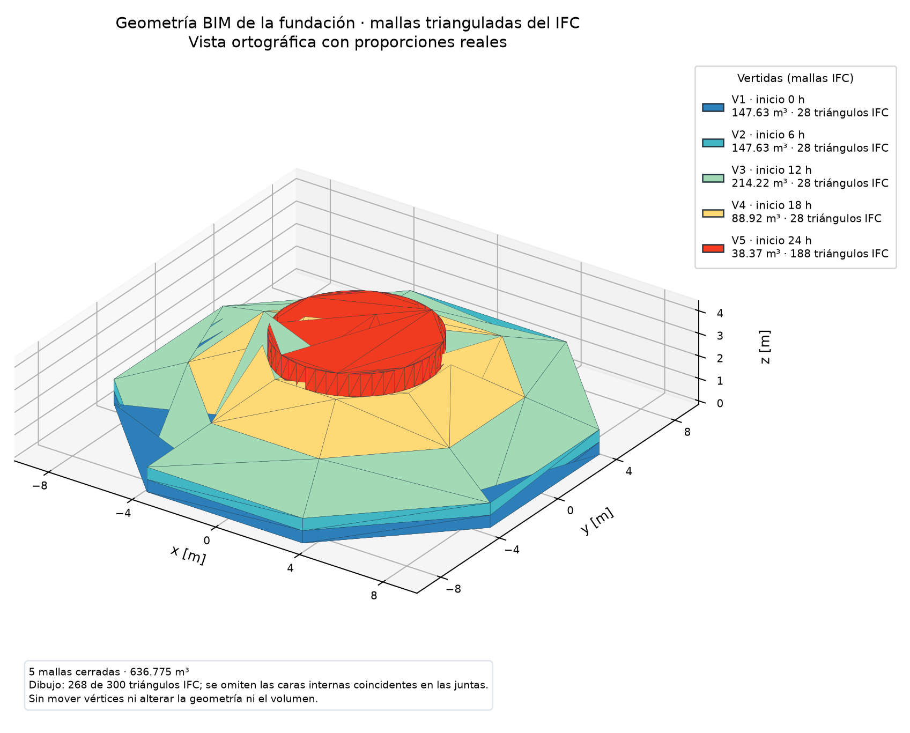
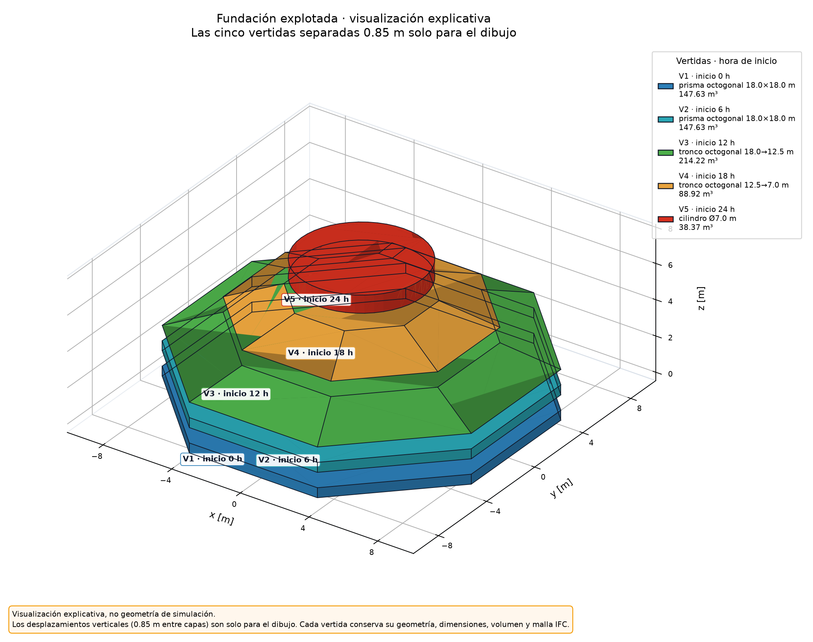
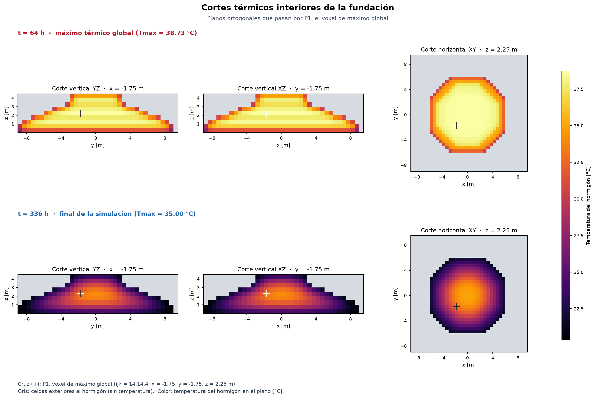
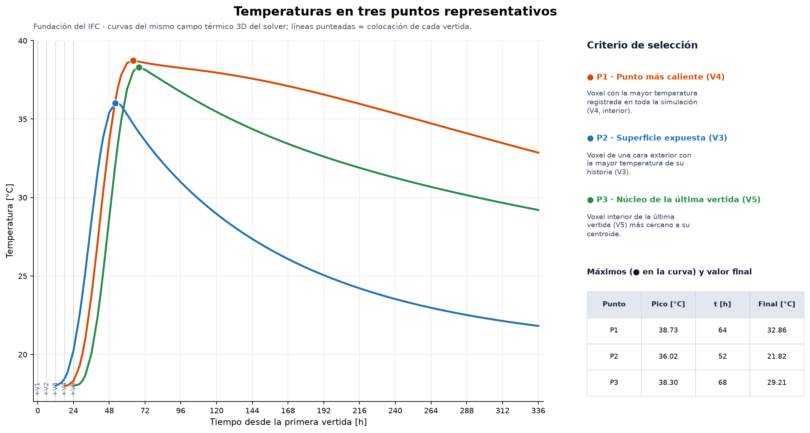
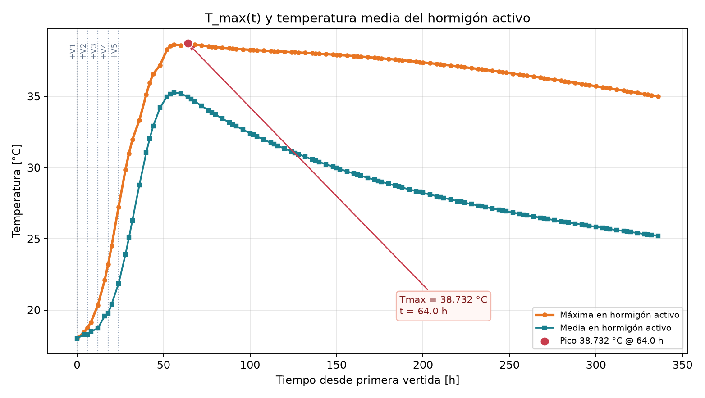

# Reporte Semana 3 — Integración IFC, voxelización y análisis térmico E09

**Equipo:** Grupo 3  
**Integrantes:** Monserrat Cubillos Tome, Josefina Ignacia Muro Teuber y Vicente Andrés Urmeneta Campos  
**Fecha:** 6 de noviembre de 2026

## 1. Objetivo y alcance

Se implementó un flujo reproducible **BIM → IFC → voxelización → solver térmico 3D** para estudiar la temperatura de una fundación de hormigón masivo construida en cinco vertidas. Los parámetros son didácticos y no están calibrados experimentalmente; por ello, los resultados caracterizan el escenario simulado, no constituyen una predicción de diseño.

## 2. Metodología

El desarrollo integra los avances de E02, E04, E07 y E08: lectura del modelo IFC, implementación y extensión del solver de difusión, condiciones de borde, fuente de hidratación, extracción y voxelización de las vertidas, y activación temporal. E09 reúne estos componentes para interpretar el campo térmico tridimensional y contrastarlo críticamente con la literatura.

### 2.1 Geometría y voxelización

El IFC contiene cinco elementos `IfcFooting`, de altura global **4,30 m** y volumen conjunto **636,775 m³**. La clasificación de centros de celda respecto de las mallas trianguladas produce, con $\Delta x=0,5\ \mathrm{m}$, una grilla de **37 × 37 × 9**, con **5140 voxeles** de hormigón, volumen discretizado **642,500 m³** y error volumétrico relativo **0,899 %**.

La **Figura 1** representa las vertidas en sus coordenadas IFC originales, sin desplazamientos. Para evitar artefactos de renderizado por caras internas coincidentes, se dibujan **268 de 300 triángulos** y se ocultan 32 triángulos duplicados en las juntas; el IFC y las mallas usadas en el cálculo conservan los 300 triángulos. La **Figura 2** separa verticalmente las cinco vertidas únicamente para visualizar su forma y secuencia: estos desplazamientos gráficos **no** se aplican a la voxelización ni al solver.





### 2.2 Modelo térmico y vertidas

Cada voxel activo satisface el balance energético:

$$
\rho c_p V\frac{dT}{dt}=\sum_f\Phi_f+\dot Q(t)V.
$$

Se adoptan $k=2,0\ \mathrm{W/(m\,K)}$, $\rho=2400\ \mathrm{kg/m^3}$ y $c_p=900\ \mathrm{J/(kg\,K)}$. Todas las caras exteriores, incluida la base, usan una condición **Robin** con ambiente constante de **20 °C** y $h=8\ \mathrm{W/(m^2\,K)}$; no se representan explícitamente suelo ni moldajes.

La hidratación se aproxima mediante un pulso cosenoidal dependiente de la edad de cada vertida, con $Q_{\max}=500\ \mathrm{W/m^3}$ y duración $\tau=48\ \mathrm{h}$; su energía integrada equivale a un ascenso adiabático ideal de **20 °C**. Las cinco vertidas se activan a **0, 6, 12, 18 y 24 h**, inicialmente a **18 °C**. La simulación cubre **336 h**, con paso máximo de **600 s** y factor de estabilidad **0,8**.

### 2.3 Indicadores térmicos

Además del máximo global y de la diferencia extrema interior–superficie, se calculó una diferencia vertical en la columna del voxel que alcanza el máximo global. En cada instante se compara el voxel interior activo más caliente de esa columna con el voxel activo superior. Esta medida depende de la columna seleccionada y **no es idéntica** a la separación núcleo–superficie superior medida por Ju y Lei.

## 3. Resultados

| Indicador | Resultado |
|---|---:|
| Temperatura máxima global | **38,732 °C**, a las **64 h** |
| Temperatura máxima al finalizar (336 h) | **35,003 °C** |
| Temperatura media final | **25,209 °C** |
| Diferencia extrema interior–superficie | **16,819 °C**, a las **174 h** |
| Diferencia vertical máxima | **13,065 °C**, a las **40 h** |
| Diferencia vertical a las 216 h | **11,097 °C** |
| Volumen voxelizado / error | **642,500 m³ / 0,899 %** |
| Residuo del balance energético | **7,629 × 10⁻⁶ J** |

La **Figura 3** compara cortes interiores a las **64 h** y **336 h**: se observa acumulación térmica interna seguida de enfriamiento. La **Figura 4** presenta tres puntos elegidos por su función física: **P1**, máximo global en V4 (**38,732 °C**, 64 h); **P2**, punto de superficie expuesta en V3 (**36,018 °C**, 52 h); y **P3**, núcleo de la última vertida V5 (**38,302 °C**, 68 h). La **Figura 5** muestra el historial de temperatura máxima y media y los instantes de activación. La lectura del control a intervalos de 6 h identifica **38,698 °C a las 66 h**; la diferencia respecto del máximo a las 64 h se debe al muestreo.







## 4. Comparación crítica con Ju y Lei (2019)

Ju y Lei estudiaron la evolución térmica de una fundación de hormigón masivo mediante instrumentación y análisis numérico. Informaron aproximadamente **73 °C en el núcleo hacia el día 4** y una diferencia núcleo–superficie superior cercana a **35 °C hacia el día 9**, asociada a riesgo de fisuración por gradientes térmicos.

Nuestro máximo (**38,732 °C a las 64 h**) es aproximadamente **34,3 °C menor**. Esta discrepancia puede relacionarse con diferencias de modelación: aquí la hidratación se representa por un pulso idealizado equivalente a **20 °C adiabáticos**, sin ajuste calorimétrico; el artículo emplea una evolución térmica vinculada a ensayos de referencia. También difieren las propiedades térmicas y las condiciones de borde. Nuestro modelo usa $k=2,0\ \mathrm{W/(m\,K)}$, $c_p=900\ \mathrm{J/(kg\,K)}$, convección constante $h=8\ \mathrm{W/(m^2\,K)}$ y aire fijo a 20 °C. El estudio utiliza parámetros y condiciones ambientales diferentes, incluyendo la interacción con elementos constructivos y el entorno.

La secuencia de cinco vertidas, sus edades térmicas y la geometría voxelizada también modifican la distribución de temperatura; **no se cuantificó su efecto individual** mediante simulaciones de sensibilidad. A las **216 h**, nuestra diferencia vertical es **11,097 °C**, frente a los aproximadamente **35 °C** de Ju y Lei; no son indicadores estrictamente equivalentes, pues difieren la posición y el procedimiento de evaluación. Por tanto, los menores valores simulados **no demuestran por sí solos ausencia de riesgo de fisuración**.

## 5. Limitaciones

La discretización por voxeles introduce escalonamiento de frontera; no calcula fracciones de volumen de celdas cortadas. La hidratación depende solo de la edad y no incorpora cinética calibrada ni retroalimentación térmica. No se simulan explícitamente suelo, moldajes, radiación, lluvia o clima variable. La resolución de **0,5 m** limita el detalle de gradientes y no se calcula el estado tensional ni la fisuración. Falta contrastar el modelo con mediciones experimentales.

## 6. Reproducibilidad

Desde la raíz del repositorio:

```powershell
python .\scripts\demo_pipeline_ifc_3d.py --modo-e09
```

El modo E09 guarda resultados y evidencias en `results/semana3_e09`: **cinco PNG** (las Figuras 1–5), **cuatro CSV de evidencia** (`metricas_e09.csv`, `perfil_vertical_e09.csv`, `puntos_representativos.csv` y `puntos_representativos_series.csv`). Las evidencias anteriores se archivan, sin alterar las entregas previas. La validación reportada reprodujo **38,73172857 °C a las 64 h**, **5140 voxeles**, **642,500 m³** y **35,00250634 °C al final**. Según el registro de ejecución, se aprobaron **86 pruebas** mediante `python scripts/run_tests.py`.

## 7. Referencia

Ju, Y. y Lei, H. (2019). *Actual Temperature Evolution of Thick Raft Concrete Foundations and Cracking Risk Analysis*. **Advances in Materials Science and Engineering**. https://doi.org/10.1155/2019/7029671
